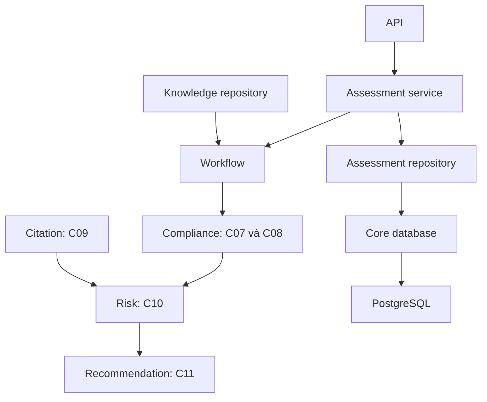

# Kiến trúc backend theo module

Backend là modular monolith Python/FastAPI. Package `legal_checker` dùng src layout tại `backend/src/legal_checker/`; nghiệp vụ và repository được đặt cùng module theo cấu trúc người dùng chọn.

```text
backend/
├── src/
│   ├── legal_checker/
│   │   ├── main.py
│   │   ├── api/v1/                 # contracts, assessments, reviews, reports, legal_knowledge
│   │   ├── core/                   # config, postgres, security, logging, exceptions
│   │   ├── migrations/             # Alembic env, revisions, SQL baseline, legacy adoption
│   │   ├── shared/                 # contracts, llm audit, storage, ids, validation
│   │   ├── modules/
│   │   │   ├── documents/
│   │   │   ├── legal_knowledge/
│   │   │   ├── applicable_law/
│   │   │   ├── citation_validation/
│   │   │   ├── retrieval/
│   │   │   ├── compliance/
│   │   │   ├── risks/
│   │   │   ├── recommendations/
│   │   │   ├── assessments/
│   │   │   ├── reviews/
│   │   │   └── reports/
│   │   ├── workflows/              # assessment_workflow, steps_5_7, handoffs, states
│   │   └── worker/                 # celery_app và tasks, chưa cấu hình queue
│   └── devtools/                   # Tải dataset, seed SQL và kiểm tra QA
├── tests/{unit,integration,contract,e2e}/
├── alembic.ini
├── pyproject.toml
└── Dockerfile
```

[Backend README](../backend/README.md) mô tả trạng thái và trách nhiệm từng folder. `frontend`, `scripts`, `docs`, `data`, `configs` và `evals` vẫn ở root repo. Tài liệu BRD/contracts người dùng cung cấp được giữ làm baseline, kể cả các ví dụ cấu trúc cũ trong tài liệu gốc.

## Mapping BRD

| Bước / Chức năng | Module | Dữ liệu và trạng thái |
|---|---|---|
| 1–2 Document | `documents` | C01 → C02/C03/chunks; interfaces, chưa có parser/OCR thật |
| Knowledge | `legal_knowledge` | Repository PostgreSQL và immutable snapshots; curation/versioning là interface |
| 3A Scope/Temporal | `applicable_law` | C02 → C04 → C05; interfaces |
| 3B Citation | `citation_validation` | C03 + profile/knowledge → C09; interface độc lập |
| 4 Retrieval | `retrieval` | C05 + chunks → C06; interfaces |
| 5 Compliance | `compliance` | C07 có provider/review/grounding, bốn findings, 7 loại criterion và 12 numeric schema; C08 áp dụng AGG_CAN_HO_V1; service compliance-only đã chạy |
| 6 Risk | `risks` | C07 + C09 → C10; hai mappers, policy guards, source XOR và dedup đã triển khai |
| 7 Recommendation | `recommendations` | C10 + pinned templates → C11; selection/facts/constraints validation, diagnostics và PENDING |
| Assessment | `assessments` | Runner offline/replay/save/read/export và PostgreSQL Store; service/API full assessment còn interface |
| 8 Review | `reviews` | C12 service/repository interfaces, chưa triển khai |
| 9 Report | `reports` | Builder C13 ghép C10/C11 được cung cấp; chưa export/persist/publish |

## Dependency

- API dùng shared contracts và gọi module service/workflow; API không chứa rules pháp lý.
- Workflows chọn thứ tự gọi, truyền context/knowledge và kiểm tra bàn giao.
- Module sở hữu thuật toán, prompts, queries và repository của mình.
- `core/postgres.py` tạo connection chung; repository sở hữu SQL và transaction. Knowledge và assessment repositories đang dùng PostgreSQL.
- Module tự sở hữu LLM/embeddings, client/provider/prompt. `shared/llm/audit.py` cung cấp X02 sink/helper dùng chung. `shared/storage/http.py` triển khai đọc nguồn HTTP(S), kiểm tra SHA-256 và cache local cho nhóm A; [hướng dẫn](source_storage.md).
- Alembic quản lý schema qua `migrations/versions/`; ba revision đầu dùng SQL baseline trong `migrations/sql/`. `scripts.local_db init` chạy tới head và kiểm tra lịch sử/checksum/cấu trúc trước khi tiếp nhận DB dùng runner cũ. Xem [quy trình migration](database_migrations.md).
- C07 tách proposal AI khỏi review/backend verification; C08 tổng hợp checklist; C10 hợp nhất hai nhánh độc lập; C11 dùng templates đã pin. Các engines/services và `steps_5_7.evaluate` đã triển khai. [Cách chạy, giới hạn và kiểm tra](../backend/src/legal_checker/modules/compliance/README.md).
- Contracts chỉ mô tả dữ liệu. Runtime không import `devtools`.
- `main.create_app` và `api.dependencies.build_services` chọn implementations; các Protocol được đặt cùng module sở hữu.

Luồng mục tiêu sau khi triển khai API assessment toàn bộ; hiện chưa có endpoint khởi chạy luồng này:



Applicable Law chỉ nhận profile/scope/knowledge; Citation Validation nhận citations/profile/knowledge riêng. C09 hội tụ ở Risk/Report, không sửa C05 hoặc C08. C05 vẫn là context/checklist cho Retrieval và Compliance; C06 chỉ là evidence references.

`DraftAssessmentWorkflow` trong `workflows/assessment_workflow.py` ghép implementations
upstream được inject và chạy bước 5–7. Nó giữ C01 pin, C04/C05/C06, C03/C09 và C07–C11
trong `AssessmentDraft`, sao chép DTO giữa adapters và kiểm tra C06 trước provider.
Retrieval/Observation/Citation có thể vắng mặt tường minh: giữ diagnostics và uncertainty,
không tạo upstream giả. External registry phải được inject độc lập từ backend đáng tin.
Đây chưa phải hệ thống đã triển khai toàn bộ bước 1–9; fixtures upstream không chứng
minh chất lượng OCR/LLM/retrieval hoặc thay review pháp lý.

## Điểm đặt code và interfaces còn lại

| Chức năng trước | Nơi sở hữu hiện tại |
|---|---|
| Criterion reasoning + requirement aggregation | `modules/compliance/criterion_reasoner.py`, `requirement_aggregator.py` |
| Entry point Compliance | `modules/compliance/service.py:evaluate_compliance` |
| Risk branches | `modules/risks/compliance_mapper.py`, `citation_mapper.py`, `aggregator.py` |
| Recommendation | `modules/recommendations/generator.py`, `validator.py` |
| PostgreSQL knowledge reader | `modules/legal_knowledge/repository.py` |
| PostgreSQL run store | `modules/assessments/repository.py`, connection chung trong `core/postgres.py` |
| C13 draft | `modules/reports/builder.py` |
| Document/source/search interfaces | `modules/documents/parser.py`, `shared/storage/source.py`, `modules/retrieval/` |
| Khởi tạo dependency | `api/dependencies.py`, được gọi từ `main.py` |

Không giữ package `app`, `business_modules`, `adapters`, `workflows/interfaces` hay import aliases cho đường dẫn trước. Contracts API được giữ; knowledge/run persistence đã chuyển sang PostgreSQL. Các endpoint hiện có được giữ; routes reviews/reports/contracts mới chỉ có APIRouter rỗng.

Xem [khởi tạo](startup.md), [nối module](module_integration.md) và [hướng dẫn nhóm](huong_dan_trien_khai_module_sau_seed.md).

<a id="trạng-thái-skeleton-bước-57"></a>

## Trạng thái triển khai bước 5–7

Các entrypoint dưới đây đã chạy bằng engines thật, có tests nghiệp vụ và DB integration.
Chúng là hàm Python thuần nhận context/knowledge và DTO đã validate; DB/HTTP/LLM nằm
ở repository/provider. `evaluate_compliance` chỉ tạo risks/actions từ compliance;
`steps_5_7.evaluate` nhận C09 để hợp nhất đủ hai nhánh.

| Module | Input | Output | File triển khai |
|---|---|---|---|
| Compliance | C05 + C06 + chunks/facts/observations + knowledge đã pin | C07 rồi C08 | `criterion_reasoner.py`, `grounding_validator.py`, `requirement_aggregator.py`, `service.py` |
| Risks | C07 + C09 + C05/context/knowledge | C10, giữ provenance hai nhánh | `compliance_mapper.py`, `citation_mapper.py`, `aggregator.py`, `service.py` |
| Recommendations | C10 + C05/context + knowledge | C11 chờ review | `generator.py`, `validator.py`, `service.py` |

`criterion_reasoner.reason` xử lý bốn findings từ Observation đã review bởi backend,
grounding và 12 numeric schema allowlist. Mỗi criterion của version resolved đều có
kết quả; C05 unresolved không tạo criterion giả và được C08 giữ INSUFFICIENT. C08
đối chiếu checklist đầy đủ và thực thi AGG_CAN_HO_V1, không dùng tỷ lệ SATISFIED thay rule.
C07 thiếu context/contract/hash không được downstream nhận như output đã pin.

C10 có source XOR C07/C09, severity từ catalog và dedup giữ mọi rule match. C09 thiếu
provenance có diagnostics, không tạo risk khẳng định STALE/INVALID; UNKNOWN chỉ thành
VERIFICATION khi policy cho phép. C11 bind đúng risk instance, render mọi mapped template
theo ALL, kiểm tra facts/required elements/constraints và giữ PENDING/NO_LLM metadata.

Các routes POST chạy riêng reasoning/aggregation/risks/recommendations/pipeline đã xóa.
Contracts dùng để bàn giao nội bộ; API khởi chạy assessment toàn bộ chưa triển khai.

Giữ nguyên contracts C01–C13, Knowledge PostgreSQL reader, Store, migrations, scripts tải dataset/seed và dữ liệu tham chiếu đã khóa phiên bản. GET knowledge/run vẫn dùng được. Dữ liệu EXPECTED trong QA là kết quả tham chiếu của phiên bản dựng dataset trước đây; không chứng minh module hiện tại đã triển khai hoặc đã pass eval.

`reports.build_draft_report` chỉ ghép dữ liệu được truyền vào. Caller phải cung cấp `risks=` và `recommendations=` là C10/C11 đã hợp nhất; builder không tự chạy bước 6–7.

`modules.assessments.run_group_c` hỗ trợ offline/replay, save, read exact run và export
vào thư mục mới. Runner không tạo paid client; không gắn reference observations/EXPECTED
làm đáp án. `Store.save` ghi normalized C07/C08/C10/C11, full DTO, snapshots, pins và
output lineage trong transaction. Retry cùng input/case/run trả output cũ; input khác
cùng run conflict. Các đường đọc kiểm tra cả checksum, graph ownership, pinned knowledge,
normalized rows và lineage trong transaction nhất quán, không chạy lại engines.

Nhóm D phải dùng `Store.get/get_input/get_lineage` với cặp case/run cụ thể để dựng
report. Không fallback sang run mới nhất/QA EXPECTED hoặc ghép dữ liệu legacy thiếu
lineage. Draft/unverified flags vẫn giữ; snapshot không đồng nghĩa phê duyệt pháp lý.

[Bàn giao nhóm C](group_c_handoff.md) chứa bằng chứng checks và demo save/read,
mapping DB, lệnh PowerShell và các phụ thuộc ngoài phạm vi. Các phần còn lại là upstream
thật bước 1–4, review C12, report persistence/export/UI, assessment API và worker.

## Audit LLM dùng chung

`Services.llm_audit` được factory khởi tạo bằng `PostgresLlmAuditSink`, ghi vào bảng `runtime.nhat_ky_goi_llm` có sẵn. Mỗi module inject sink khi khởi tạo service; audit không chọn provider hoặc tạo client. `audit_llm_call` chỉ giữ hashes/metadata, đo latency và ghi từng attempt; không ghi raw prompt, response hoặc API key. Usage/cost chưa biết giữ null. [Quy ước, ví dụ và xử lý lỗi](llm_audit.md).
