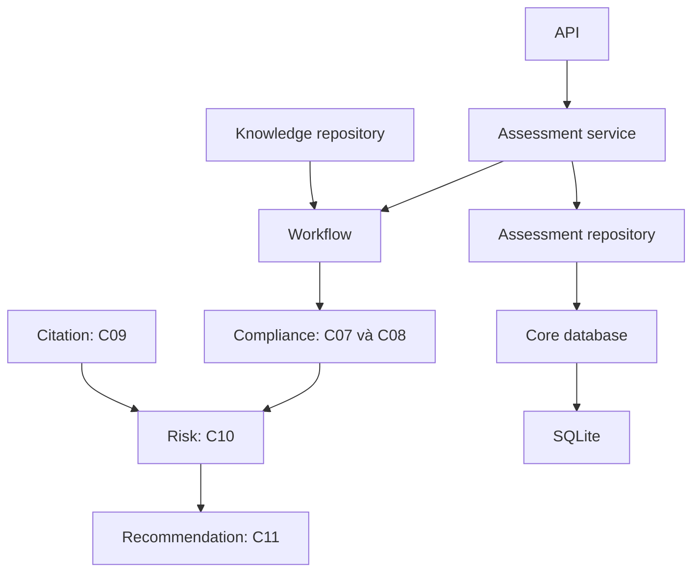

# Kiến trúc backend theo module

Backend là modular monolith Python/FastAPI. Package `legal_checker` dùng src layout tại `backend/src/legal_checker/`; nghiệp vụ và repository được đặt cùng module theo cấu trúc người dùng chọn.

```text
backend/
├── src/
│   ├── legal_checker/
│   │   ├── main.py
│   │   ├── api/v1/                 # contracts, assessments, reviews, reports, legal_knowledge
│   │   ├── core/                   # config, database, security, logging, exceptions
│   │   ├── shared/                 # contracts, llm, embeddings, storage, ids, validation
│   │   ├── modules/
│   │   │   ├── documents/
│   │   │   ├── legal_knowledge/
│   │   │   ├── applicable_law/
│   │   │   ├── citation_validation/
│   │   │   ├── retrieval/
│   │   │   ├── compliance/
│   │   │   ├── risks/
│   │   │   ├── recommendations/
│   │   │   ├── assessments/
│   │   │   ├── reviews/
│   │   │   └── reports/
│   │   ├── workflows/              # assessment_workflow, steps_5_7, handoffs, states
│   │   └── worker/                 # celery_app và tasks, chưa cấu hình queue
│   └── devtools/                   # Fixtures/replay cho phát triển
├── alembic/versions/               # Vị trí migrations, chưa cấu hình Alembic
├── tests/{unit,integration,contract,e2e}/
├── pyproject.toml
└── Dockerfile
```

[Backend README](../backend/README.md) mô tả trạng thái và trách nhiệm từng folder. `frontend`, `scripts`, `docs`, `data`, `examples`, `configs` và `evals` vẫn ở root repo. Tài liệu BRD/contracts người dùng cung cấp được giữ làm baseline, kể cả các ví dụ cấu trúc cũ trong tài liệu gốc.

## Mapping BRD

| Bước / Chức năng | Module | Dữ liệu và trạng thái |
|---|---|---|
| 1–2 Document | `documents` | C01 → C02/C03/chunks; interfaces, chưa có parser/OCR thật |
| Knowledge | `legal_knowledge` | Repository JSON có checksum; curation/versioning là interface |
| 3A Scope/Temporal | `applicable_law` | C02 → C04 → C05; interfaces |
| 3B Citation | `citation_validation` | C03 + profile/knowledge → C09; interface độc lập |
| 4 Retrieval | `retrieval` | C05 + chunks → C06; interfaces |
| 5 Compliance | `compliance` | C05/C06/observations/knowledge → C07 → C08; engines deterministic |
| 6 Risk | `risks` | C07 + C09 → C10; hai mappers giữ riêng nguồn |
| 7 Recommendation | `recommendations` | C10 + templates → C11; pending review |
| Assessment | `assessments` | Service gọi workflow, repository lưu JSON run snapshots trong SQLite |
| 8 Review | `reviews` | C12 service/repository interfaces, chưa triển khai |
| 9 Report | `reports` | Builder C13 DRAFT/PENDING; chưa export/persist/publish |

## Dependency

- API dùng shared contracts và gọi module service/workflow; API không chứa rules pháp lý.
- Workflows chọn thứ tự gọi, truyền context/knowledge và kiểm tra bàn giao.
- Module sở hữu thuật toán, prompts, queries và repository của mình.
- `core/database.py` tạo connection chung; repository sở hữu SQL và transaction. Hiện mới có assessment repository SQLite.
- LLM/embedding/storage dùng client/capability chung trong `shared`; provider implementations chưa có.
- Các hàm deterministic trong compliance/risk/recommendation không mở DB hoặc gọi provider. Khi thêm LLM, module service/observation provider ghép đề xuất với facts/gates đã xác minh.
- Contracts chỉ mô tả dữ liệu. Runtime không import `devtools`.
- `main.create_app` và `api.dependencies.build_services` chọn implementations; các Protocol được đặt cùng module sở hữu.



Applicable Law chỉ nhận profile/scope/knowledge; Citation Validation nhận citations/profile/knowledge riêng. C09 hội tụ ở Risk/Report, không sửa C05 hoặc C08. C05 vẫn là context/checklist cho Retrieval và Compliance; C06 chỉ là evidence references.

`DraftAssessmentWorkflow` trong `workflows/assessment_workflow.py` chạy khi được inject đủ upstream services. Nó giữ C01 pin, C04/C05/C06, C03/C09 và C07–C11 trong `AssessmentDraft`; chưa phải workflow đã triển khai đầy đủ bước 1–9. Fixtures upstream dùng để kiểm tra bàn giao, không chứng minh OCR/LLM/retrieval quality.

## Di chuyển code đang có

| Chức năng trước | Nơi sở hữu hiện tại |
|---|---|
| Criterion reasoning + requirement aggregation | `modules/compliance/criterion_reasoner.py`, `requirement_aggregator.py` |
| Entry point Compliance | `modules/compliance/service.py:evaluate_compliance` |
| Risk branches | `modules/risks/compliance_mapper.py`, `citation_mapper.py`, `aggregator.py` |
| Recommendation | `modules/recommendations/generator.py`, `validator.py` |
| JSON knowledge reader | `modules/legal_knowledge/repository.py` |
| SQLite run store | `modules/assessments/repository.py`, connection chung trong `core/database.py` |
| C13 draft | `modules/reports/builder.py` |
| Document/source/search interfaces | `modules/documents/parser.py`, `shared/storage/source.py`, `modules/retrieval/` |
| Khởi tạo dependency | `api/dependencies.py`, được gọi từ `main.py` |

Không giữ package `app`, `business_modules`, `adapters`, `workflows/interfaces` hay import aliases cho đường dẫn trước. API payloads, knowledge snapshot và SQLite schema giữ nguyên. Các endpoint hiện có được giữ; routes reviews/reports/contracts mới chỉ có APIRouter rỗng.

Xem [khởi tạo](startup.md), [nối module](module_integration.md) và [phát triển song song](parallel_development.md).
