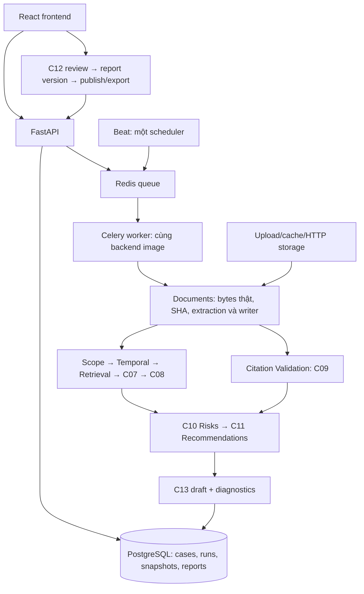

# Kiến trúc hệ thống và triển khai

Cập nhật 05/11/2026. Quyết định chuẩn: [INTEGRATION_V1](../contracts/integration_spec.md).
Bảng bàn giao H01–H24 mô tả rõ ownership năm người, nguồn dữ liệu và điều kiện nối.

## 1. Modular monolith, API và worker

Backend Python/FastAPI trong `backend/src/legal_checker/`. Mỗi business module giữ
logic, prompt, mapper và repository riêng. API không chứa rules pháp lý. Workflow
truyền DTO giữa module; không tạo HTTP/microservice cho mỗi công đoạn.

`inline` dùng cùng runner trong tiến trình API cho local; `celery` tách xử lý nền.
SSE/polling đọc trạng thái DB sau F5. Redis là broker at-least-once, PostgreSQL mới
là nguồn trạng thái và kết quả. Task gửi IDs; claim/lease/recovery chống job lặp/mất.
COMPLETED và report đầu tiên commit cùng transaction; COMPLETED chưa phải legal approval.

## 2. Cấu trúc code và dependency

| Folder | Trách nhiệm |
|---|---|
| `api/` | Auth, quyền/tenant, HTTP request/response và lỗi; gọi use case |
| `core/` | Config, DB connection, logging/metrics/security primitives |
| `shared/contracts/` | DTO và ràng buộc cấu trúc; dictionary/semantics ở docs/contracts |
| `shared/storage/` | Đọc upload/HTTP, cache theo hash và kiểm bytes |
| `shared/llm/` | Types/client/audit dùng khi module chọn; không sở hữu kết luận pháp lý |
| `modules/` | Documents, legal knowledge, scope/temporal, citations, retrieval, compliance, risks, recommendations, assessments, reviews, reports |
| `workflows/` | Compose implementations, thứ tự, handoff guards và runner |
| `worker/` | Inline/Celery queues, tasks, heartbeat/recovery |
| `migrations/` | Alembic revisions và SQL baselines |
| `devtools/` | Dataset/seed/update/QA/audit; không import vào business modules |

`main.create_app` → `api.dependencies.build_services`. Người 4 có thể cung cấp
CriterionVerificationProvider qua composition, không đặt client hoặc DB query vào
numeric/aggregation engines. Người 5 nối provider trước C07.

## 3. Hiện trạng implementation và giới hạn

| Phần | Đã có | Giới hạn cần nghiệm thu |
|---|---|---|
| Documents | Upload, PDF text parser, structural chunks, profile/facts/C03, writer | OCR/DOCX parser chưa có; field coverage và citation occurrences cần eval |
| Scope/Temporal | Rule-based scope và interval resolver từ catalog | Typed field thiếu, marker mapping/history/overlaps cần owner xác nhận |
| Citation | Identity/temporal/domain/classifier + live provenance | Tên+năm chưa có policy unique identity; UNKNOWN không tự thành VALID |
| Retrieval | BM25, fact/section metadata và tùy chọn semantic/rerank | Relevance/Recall@K trên annotations; không cần bật hybrid để coi có implementation |
| C07/C08 | Proposals, gates/grounding/Decimal, deterministic aggregation | Verifier nghiệp vụ phải inject; budget/provider/quote failures còn phải đo |
| C10/C11 | Hai nhánh risks, provenance, dedup và template actions | Nội dung retry so với thiếu hồ sơ cần nghiệm thu riêng |
| Workflow/UI | Runs, queue/recovery, status/SSE, history, evidence viewer | E2E corpus thật và failure/recovery; không suy ra chất lượng từ pods Ready |
| Review/report | C12, versioning, publish, export PDF/DOCX/JSON | Auth/tenant và REVIEW_ALL_FINDINGS_V1 cần nghiệm thu phát hành |

Các function C07/C08/C10/C11 là API Python nội bộ; không tạo lại routes POST chạy
riêng bước 5–7 cho frontend. HTTP có 26 operations trong
[OpenAPI](openapi.design.json); runtime `/openapi.json`, Swagger `/docs`.

## 4. Dữ liệu và version

Knowledge snapshot SHA, source PDF SHA, extraction/chunk version, dataset release,
rule/model/prompt, migration và app/image/GitOps revisions là các trục độc lập.
Schema `v7.4.9` không phải nhãn knowledge hoặc dataset đang dùng.

Live `modules` tải bytes thật kể cả URL remote; không fallback expected.
`modules_di_reference` và `reference` chỉ dev/eval, có nhãn riêng. Split DEV/VAL/TEST
và ảnh hưởng của chunker được giải thích ở [dataset](../database/dataset_and_corpus.md)
và [dictionary](../contracts/data_dictionary.md).

Live full-pipeline output ở `workflow_runs.draft_json`; report thật ở
`report_versions`. `assessment_runs` là persistence standalone group C. Normalized
rows trong workbook/QA giúp dev song song, không tự thay output run mới. Documents
lưu normalized extraction vì Retrieval hiện đọc metadata DB, chỉ dùng active IDs.
Xem [bảng nguồn đọc/ghi](../contracts/integration_spec.md#7-persistence-và-nguồn-đọc-thật).

## 5. Triển khai

| Môi trường | Thành phần | Mục tiêu |
|---|---|---|
| Module local | PostgreSQL riêng + Python; FE nếu cần; inline/offline mặc định | Dev logic và tests độc lập |
| Local integration k3d | FE/API, worker/Beat, Redis/PostgreSQL PVC, storage cache, ingress/observability | Nghiệm thu ghép, không gọi là production HA |
| Customer release | Cùng backend module, API và workers scale riêng | Cần auth, source storage/backup/restore, limits, secrets/TLS và nghiệm thu release |

Infrastructure repo sở hữu cluster/bootstrap; GitOps sở hữu workload desired state;
app sở hữu migration/seed/update và nghiệp vụ. App merge/build không cập nhật DB.
Argo chỉ sync branch/revision đang cấu hình, không tự theo main mọi repo.

Hiện local phase-two theo GitOps `feat/local-phase2-worker-verification`; publish
app main mặc định update GitOps main. Rollout local cần chọn đúng target branch;
không đổi Argo branch khi main GitOps chưa có cấu hình tương ứng. Đây là trạng thái
môi trường ngày 05/11, phải kiểm live trước rollout.

Một backend image chạy API/worker/Beat; không cần Dockerfile worker. Tách microservices
chỉ khi có bằng chứng cần ownership, scale, isolation hoặc lifecycle độc lập mà
modular monolith không đáp ứng; chưa có yêu cầu phải tách ngay.

## 6. Tài liệu và cách nghiệm thu

- [Hướng dẫn dev](../guides/dev_setup.md), [khởi chạy](../guides/startup.md).
- [Nguồn PDF/cache](data_flow_and_storage.md), [DB](../database/local_setup.md), [Alembic](../database/migrations.md).
- [Handoff và ownership](../contracts/integration_spec.md), [nhóm A–D](../modules/README.md).
- [DevOps/runbook](../devops/local_k3d_argocd_cicd_framework.md), [audit LLM](../guides/llm_audit.md).

Schema pass, unit/DB integration pass, provider thật, eval chất lượng và rollout là
những bằng chứng khác nhau. Changelog ghi rõ đã chạy gì; không lấy report reference
hoặc một demo làm chứng nhận toàn hệ thống sẵn sàng khách hàng.
