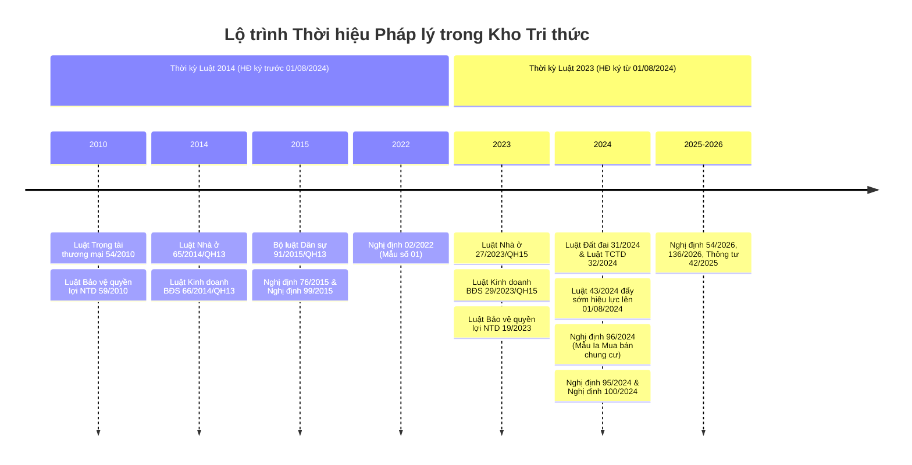

# BÁO CÁO CHI TIẾT KHO TRI THỨC PHÁP LÝ (LEGAL KNOWLEDGE BASE)

> **Bản nháp lịch sử, chưa nghiệm thu toàn bộ diễn giải pháp lý.** Các số liệu và nhận định trong nội dung cũ cần đối chiếu snapshot/source trước khi dùng làm báo cáo chính thức. Không sử dụng làm bằng chứng benchmark hoặc tư vấn pháp lý. Xem [báo cáo tuần 10 đã điều chỉnh](bao_cao_tien_do_tuan_10.md), [tuần 11](bao_cao_tien_do_tuan_11.md) và [trạng thái các slide](slides/README.md).
**Dự án:** Legal AI Compliance Checker (C01 – C13)
**Phiên bản Tri thức:** `V750_KNOWLEDGE_OWNER_APPROVED_20261110` (Schema `v7.4.9`)
**Mã băm Bất biến (Snapshot SHA-256):** `4ab2d7ea296ea908e25c09fcb6d5f073f1ebe1917678b36390f803b1c725804a`
**Trạng thái Thẩm định:** `HUMAN_VERIFIED`
**Ngày phát hành:** 10/11/2026

---

## 1. TỔNG QUAN VÀ MỤC TIÊU CỦA KHO TRI THỨC PHÁP LÝ

Kho tri thức pháp lý (Legal Knowledge Base - Schema `knowledge`) là trung tâm tri thức của toàn bộ hệ thống **Legal AI Compliance Checker**. Khác với các hệ sinh thái AI thông thường chỉ dựa vào Prompt và bộ nhớ ngữ cảnh của mô hình ngôn ngữ lớn (LLM), hệ thống này xây dựng một **Cơ sở tri thức Pháp điển hóa và Cấu trúc hóa cao độ (Structured Legal Knowledge Graph)**, chuyển hóa ngôn ngữ văn bản luật thành các thực thể, thuộc tính thời hiệu, ràng buộc số học và quy tắc suy luận logic xác định.

### 1.1. Mục tiêu Nghiệp vụ
1. **Pháp điển hóa Toàn diện:** Bao quát toàn bộ khung pháp lý điều chỉnh hoạt động mua bán căn hộ chung cư thương mại tại Việt Nam qua các thời kỳ.
2. **Định tuyến Thời hiệu Tự động:** Nhận diện và áp dụng chính xác chế định pháp luật tương ứng với thời điểm giao kết hợp đồng (trước hoặc từ ngày 01/08/2024).
3. **Loại bỏ Ảo giác (Zero Hallucination):** Khóa cứng các ngưỡng số học (thời hạn bảo hành, tỷ lệ thanh toán, kinh phí bảo trì) thành các quy tắc quyết định có thể chứng minh toán học.
4. **Quản trị Rủi ro Đa tầng:** Tự động đối chiếu từng tiêu chí với thư viện rủi ro chuẩn hóa và sinh mẫu khuyến nghị chỉnh sửa điều khoản bám sát thực tiễn.

---

## 2. QUY MÔ ĐỊNH LƯỢNG KHO TRI THỨC

Toàn bộ kho tri thức được lưu trữ tập trung tại cơ sở dữ liệu PostgreSQL dưới schema `knowledge` với 23 bảng quan hệ, đạt quy mô định lượng cụ thể như sau:

| Thực thể Tri thức | Bảng Cơ sở Dữ liệu | Số lượng Bản ghi | Mô tả Chức năng |
| :--- | :--- | :---: | :--- |
| **Văn bản Quy phạm Pháp luật** | `knowledge.van_ban_phap_ly` | **37** | Toàn bộ Luật, Nghị định, Thông tư, Quyết định và Văn bản hợp nhất điều chỉnh hợp đồng mua bán nhà ở. |
| **Điều khoản Pháp luật Chi tiết** | `knowledge.dieu_khoan_phap_ly` | **2.074** | Từng Điều, Khoản, Điểm được bóc tách và lập chỉ mục văn bản gốc. |
| **Yêu cầu Pháp lý Cốt lõi** | `knowledge.yeu_cau_phap_ly` | **323** | Các nhóm nghĩa vụ bắt buộc của hợp đồng mua bán chung cư thương mại. |
| **Phiên bản Yêu cầu theo Mốc** | `knowledge.phien_ban_yeu_cau` | **357** | Phân nhánh yêu cầu theo hiệu lực thời gian và chế định pháp luật. |
| **Tiêu chí Đánh giá Chi tiết** | `knowledge.tieu_chi_danh_gia` | **479** | Đơn vị kiểm tra nhỏ nhất của hệ thống phục vụ chấm điểm tuân thủ. |
| **Quy tắc Quyết định Logic** | `knowledge.quy_tac_quyet_dinh` | **1.916** | Các điều kiện JSONB xác định ngưỡng số học và phán quyết tuân thủ. |
| **Danh mục Rủi ro Pháp lý** | `knowledge.danh_muc_rui_ro` | **1.161** | Thư viện rủi ro gắn với từng tiêu chí vi phạm. |
| **Danh mục Khuyến nghị Sửa đổi**| `knowledge.danh_muc_khuyen_nghi` | **1.161** | Mẫu điều khoản gợi ý sửa đổi cho chuyên viên pháp chế và luật sư. |
| **Quy tắc Gán Rủi ro** | `knowledge.quy_tac_rui_ro` | **1.161** | Liên kết logic từ vi phạm tiêu chí sang phân loại mức độ rủi ro (High/Medium/Low). |
| **Phạm vi Áp dụng** | `knowledge.pham_vi_ap_dung` | **327** | Khai báo loại hình bất động sản và tư cách chủ thể được điều chỉnh. |
| **Ngoại lệ Áp dụng** | `knowledge.ngoai_le_ap_dung` | **9** | Các trường hợp đặc thù được miễn trừ hoặc có cơ chế áp dụng riêng. |
| **Mối Quan hệ Văn bản** | `knowledge.quan_he_van_ban` | **20** | Mạng lưới quan hệ: thay thế, sửa đổi, bổ sung, quy định chi tiết. |
| **Nguồn Yêu cầu** | `knowledge.nguon_yeu_cau` | **376** | Truy vết nguồn gốc điều khoản luật định cho từng yêu cầu. |
| **Snapshot Bất biến** | `knowledge.knowledge_snapshots` | **1** | Bản đóng băng toàn bộ tri thức phục vụ kiểm định khoa học. |

---

## 3. PHÂN LOẠI 37 VĂN BẢN QUY PHẠM PHÁP LUẬT THEO THỜI HIỆU

Kho tri thức quản lý **37 văn bản pháp quy** được chia thành 2 chế định thời gian trọng tâm, lấy ngày **01/08/2024** làm ranh giới bản lề:



### 3.1. Chế định 1: Giai đoạn 2014 – 31/07/2024 (Thời kỳ Luật Nhà ở & Luật KDBĐS 2014)
Áp dụng đối với các hợp đồng có ngày ký kết từ ngày 01/07/2015 đến trước ngày 01/08/2024:
1. **Luật Nhà ở số 65/2014/QH13:** Điều chỉnh các vấn đề về phân hạng nhà chung cư, phần sở hữu chung/riêng, kinh phí bảo trì 2%, và nghĩa vụ bảo hành căn hộ tối thiểu 60 tháng (Điều 85).
2. **Luật Kinh doanh bất động sản số 66/2014/QH13:** Điều chỉnh điều kiện của bất động sản hình thành trong tương lai được đưa vào kinh doanh, điều kiện thanh toán từng đợt (Điều 57: không quá 70% trước bàn giao, không quá 95% trước khi cấp sổ).
3. **Bộ luật Dân sự số 91/2015/QH13:** Điều chỉnh nguyên tắc giao kết hợp đồng, phạt vi phạm, bồi thường thiệt hại và điều khoản bất khả kháng.
4. **Luật Bảo vệ quyền lợi người tiêu dùng số 59/2010/QH12:** Quy định về hợp đồng theo mẫu và điều kiện giao dịch chung.
5. **Nghị định 76/2015/NĐ-CP:** Quy định chi tiết thi hành Luật Kinh doanh bất động sản 2014.
6. **Nghị định 02/2022/NĐ-CP:** Thay thế Nghị định 76/2015/NĐ-CP, ban hành Mẫu hợp đồng mua bán căn hộ chung cư số 01.
7. **Nghị định 99/2015/NĐ-CP:** Quy định chi tiết thi hành một số điều của Luật Nhà ở 2014.
8. **Thông tư 02/2016/TT-BXD & Thông tư 28/2016/TT-BXD:** Quy chế quản lý, sử dụng nhà chung cư.
9. **Quyết định 02/2012/QĐ-TTg & Quyết định 35/2015/QĐ-TTg:** Danh mục hàng hóa, dịch vụ thiết yếu phải đăng ký hợp đồng theo mẫu.

### 3.2. Chế định 2: Giai đoạn từ 01/08/2024 đến nay (Thời kỳ Luật Mới 2023)
Áp dụng đối với các hợp đồng ký kết từ ngày 01/08/2024 trở đi:
1. **Luật Nhà ở số 27/2023/QH15:** Có hiệu lực sớm từ ngày 01/08/2024 (theo Luật số 43/2024/QH15). Điều chỉnh chặt chẽ thời hạn sử dụng nhà chung cư theo hồ sơ thiết kế, quy định bảo hành tại Điều 129.
2. **Luật Kinh doanh bất động sản số 29/2023/QH15:** Siết chặt việc công khai thông tin dự án, quy định đặt cọc không quá 5% giá bán, giảm tỷ lệ thanh toán đợt đầu và thanh toán trước bàn giao xuống mức tối đa 50% đối với doanh nghiệp có vốn đầu tư nước ngoài.
3. **Luật Bảo vệ quyền lợi người tiêu dùng số 19/2023/QH15:** Mở rộng danh mục điều khoản không được phép đưa vào hợp đồng theo mẫu.
4. **Luật Đất đai số 31/2024/QH15 & Luật Các tổ chức tín dụng số 32/2024/QH15:** Điều chỉnh quyền sử dụng đất xây dựng chung cư và cơ chế bảo lãnh ngân hàng.
5. **Luật số 43/2024/QH15:** Đẩy sớm thời điểm có hiệu lực của Luật Nhà ở, Luật KDBĐS và Luật Đất đai từ 01/01/2025 lên 01/08/2024.
6. **Nghị định 96/2024/NĐ-CP:** Quy định chi tiết một số điều của Luật Kinh doanh bất động sản 2023; ban hành **Mẫu hợp đồng Ia** (Phụ lục I) bắt buộc áp dụng cho mua bán căn hộ chung cư thương mại.
7. **Nghị định 95/2024/NĐ-CP:** Quy định chi tiết thi hành Luật Nhà ở 2023.
8. **Nghị định 100/2024/NĐ-CP, 261/2025/NĐ-CP, 136/2026/NĐ-CP:** Quy định phát triển và quản lý nhà ở xã hội.
9. **Nghị định 54/2026/NĐ-CP:** Sửa đổi các Nghị định trong lĩnh vực nhà ở và kinh doanh bất động sản.
10. **Thông tư 42/2025/TT-BCT & Nghị định 146/2025/NĐ-CP:** Cập nhật danh mục hàng hóa thiết yếu và thẩm quyền kiểm tra hợp đồng mẫu.

---

## 4. CẤU TRÚC 35 NHÓM NGHĨA VỤ PHÁP LÝ (`nhom_nghia_vu`)

323 yêu cầu pháp lý được phân bổ trên 35 nhóm nghĩa vụ cốt lõi, bao phủ toàn bộ vòng đời và cấu trúc của hợp đồng:

| STT | Mã Nhóm Nghĩa Vụ | Số Yêu Cầu | Phạm Vi Điều Chỉnh Trọng Tâm |
| :---: | :--- | :---: | :--- |
| 1 | `A_HINH_THUC_NOI_DUNG` | 25 | Hình thức bắt buộc, các nội dung bắt buộc phải có theo mẫu luật định |
| 2 | `R_BAT_KHA_KHANG_CHAM_DUT_HIEU_LUC` | 23 | Điều khoản bất khả kháng, đơn phương chấm dứt, hoàn tiền và hiệu lực thi hành |
| 3 | `VB_DS_2015` | 22 | Các nguyên tắc chung về giao kết, phạt vi phạm, bồi thường theo Bộ luật Dân sự |
| 4 | `T_CHI_TIET_KIEM_TRA_MAU_IA` | 18 | Đối chiếu chi tiết từng điều khoản mẫu theo Mẫu Ia Nghị định 96/2024/NĐ-CP |
| 5 | `M_QUYEN_NGHIA_VU_BEN_MUA` | 17 | Quyền yêu cầu cung cấp thông tin, nhận bàn giao, khiếu nại của người mua |
| 6 | `B_DIEU_KHOAN_CAM` | 15 | Các điều khoản hạn chế quyền người mua hoặc miễn trừ trách nhiệm vô lý bị cấm |
| 7 | `I_CHU_THE_DOI_TUONG` | 15 | Tư cách pháp nhân bên bán, thẩm quyền đại diện, tính hợp pháp của căn hộ |
| 8 | `CAN_HO` | 15 | Đặc tả kỹ thuật căn hộ, diện tích sàn, diện tích thông thủy, trang thiết bị bàn giao |
| 9 | `H_NGHIA_VU_BEN_BAN` | 15 | Nghĩa vụ thi công đúng tiến độ, xin cấp sổ hồng, bảo đảm chất lượng công trình |
| 10 | `L_QUYEN_NGHIA_VU_BEN_BAN` | 13 | Quyền thu tiền, đơn phương chấm dứt khi bên mua chậm nộp tiền |
| 11 | `P_CHUYEN_NHUONG_SO_HUU_VAN_HANH` | 13 | Quy định về phần diện tích sở hữu chung, chỗ để xe, phí quản lý vận hành |
| 12 | `J_GIA_THANH_TOAN_BAO_TRI` | 11 | Tổng giá bán, thuế GTGT, kinh phí bảo trì 2%, tiến độ giải ngân |
| 13 | `S_CONG_KHAI_THONG_TIN_DU_AN` | 10 | Công khai giấy phép xây dựng, nghiệm thu, văn bản đủ điều kiện bán nhà |
| 14 | `V_NHAT_QUAN_NOI_BO` | 10 | Tính nhất quán số liệu giữa thân hợp đồng và các phụ lục đính kèm |
| 15 | `E_DANG_KY_CONG_KHAI` | 10 | Thủ tục đăng ký hợp đồng theo mẫu với cơ quan quản lý người tiêu dùng |
| 16 | `VB_DT_2023` | 9 | Nghĩa vụ tuân thủ Luật Đất đai mới về quyền sử dụng đất chung cư |
| 17 | `N_THUE_BAN_GIAO` | 9 | Thời hạn bàn giao nhà, biên bản bàn giao, xử lý chậm bàn giao |
| 18 | `Q_VI_PHAM_CAM_KET` | 8 | Lãi phạt chậm thanh toán, lãi phạt chậm bàn giao nhà |
| 19 | `HIST_KDBDS_2014` | 7 | Các điều khoản đặc thù chỉ áp dụng theo Luật KDBĐS 2014 |
| 20 | `G_DIEU_KIEN_KINH_DOANH` | 7 | Điều kiện bán nhà ở hình thành trong tương lai |
| 21 | `O_BAO_HANH` | 7 | Chế độ bảo hành: thời hạn (>= 60 tháng), nội dung, trách nhiệm sửa chữa |
| 22 | `F_SU_DUNG_MAU` | 6 | Nghĩa vụ tuân thủ mẫu hợp đồng của cơ quan nhà nước có thẩm quyền |
| 23 | `HIST_NHAO_2014` | 6 | Các quy định chuyển tiếp của Luật Nhà ở 2014 |
| 24 | `VB_TT_2010` | 5 | Điều khoản giải quyết tranh chấp thông qua Trọng tài thương mại |
| 25 | `D_TRINH_BAY` | 5 | Quy cách phông chữ, cỡ chữ, bố cục trình bày văn bản theo mẫu |
| 26 | `HIST_CONSUMER_2010` | 4 | Quy định bảo vệ người tiêu dùng giai đoạn 2011–2024 |
| 27 | `G_THANH_TOAN` | 4 | Hình thức thanh toán qua tài khoản ngân hàng mở tại TCTD |
| 28 | `K_CHAT_LUONG_HA_TANG` | 4 | Tiêu chuẩn chất lượng xây dựng, hệ thống PCCC, cấp thoát nước |
| 29 | `U_BAO_VE_THONG_TIN_NGUOI_TIEU_DUNG` | 3 | Bảo vệ dữ liệu cá nhân, thông tin CCCD của người mua |
| 30 | `C_THUC_HIEN_HOP_DONG` | 2 | Nguyên tắc thiện chí, trung thực trong thực hiện hợp đồng |
| 31–35 | `SOCIAL_HOUSING / NOXH` (5 nhóm) | 5 | Các quy định về đối tượng, điều kiện thu nhập và giá nhà ở xã hội |

---

## 5. MÔ HÌNH HÓA TIÊU CHÍ & QUY TẮC QUYẾT ĐỊNH (DECISION RULES)

### 5.1. Cấu trúc Tiêu chí Đánh giá (`knowledge.tieu_chi_danh_gia`)
Mỗi tiêu chí đánh giá trong hệ thống là một cấu trúc dữ liệu hoàn chỉnh:
* `tieu_chi_id`: Mã định danh duy nhất (ví dụ: `TC_PV_HYC053_01`).
* `noi_dung`: Mô tả ngữ nghĩa của tiêu chí (ví dụ: *"Thời hạn bảo hành nhà chung cư tối thiểu là 60 tháng kể từ ngày hoàn thành việc xây dựng và nghiệm thu đưa vào sử dụng"*).
* `loai_kiem_tra`: Phân loại kiểm tra (`NUMERIC_THRESHOLD`, `BOOLEAN_PRESENCE`, `SEMANTIC_MATCH`, `CROSS_SECTION_CONSISTENCY`).
* `missing_policy`: Chính sách xử lý khi thiếu dữ liệu (`FALLBACK_UNKNOWN`, `DEFAULT_SATISFIED`, `CRITICAL_VIOLATION`).
* `can_cu_cu_the`: Điều khoản nguồn (ví dụ: *"Khoản 2 Điều 85 Luật Nhà ở 2014; Khoản 2 Điều 129 Luật Nhà ở 2023"*).

### 5.2. Cấu trúc Quy tắc Quyết định Logic (`knowledge.quy_tac_quyet_dinh`)
1.916 quy tắc quyết định sử dụng cấu trúc JSONB `dieu_kien_json` được nạp sẵn vào cơ sở dữ liệu. Ví dụ thực tế về bộ quy tắc chấm tiêu chí bảo hành:

```json
[
  {
    "quy_tac_id": "QT_HYC053_01_01",
    "tieu_chi_id": "TC_PV_HYC053_01",
    "uu_tien": 1,
    "dieu_kien_json": {
      "operator": "LESS_THAN",
      "field": "thoi_han_bao_hanh_thang",
      "threshold": 60
    },
    "finding": "VIOLATED",
    "ly_do_chuan": "Thời hạn bảo hành căn hộ ({thoi_han_bao_hanh_thang} tháng) thấp hơn mức tối thiểu 60 tháng theo quy định tại Điều 85 Luật Nhà ở 2014."
  },
  {
    "quy_tac_id": "QT_HYC053_01_02",
    "tieu_chi_id": "TC_PV_HYC053_01",
    "uu_tien": 2,
    "dieu_kien_json": {
      "operator": "GREATER_OR_EQUAL",
      "field": "thoi_han_bao_hanh_thang",
      "threshold": 60
    },
    "finding": "SATISFIED",
    "ly_do_chuan": "Thời hạn bảo hành căn hộ đạt {thoi_han_bao_hanh_thang} tháng, đáp ứng quy định tối thiểu 60 tháng."
  },
  {
    "quy_tac_id": "QT_HYC053_01_03",
    "tieu_chi_id": "TC_PV_HYC053_01",
    "uu_tien": 3,
    "dieu_kien_json": {
      "operator": "IS_NULL",
      "field": "thoi_han_bao_hanh_thang"
    },
    "finding": "UNKNOWN",
    "ly_do_chuan": "Hợp đồng không ghi rõ thời hạn bảo hành căn hộ bằng số tháng cụ thể. Cần thẩm định thủ công."
  }
]
```

---

## 6. DANH MỤC RỦI RO & KHUYẾN NGHỊ SỬA ĐỔI

Kho tri thức tích hợp sẵn **1.161 rủi ro pháp lý** và **1.161 mẫu khuyến nghị tương ứng**, được ánh xạ trực tiếp từ các tiêu chí vi phạm:

### 6.1. Phân loại 3 Mức độ Rủi ro (`muc_do_rui_ro`)
1. **Rủi ro Mức độ CAO (HIGH):**
   * Các hành vi vi phạm điều cấm hoặc ngưỡng số học tối thiểu do luật định.
   * *Ví dụ:* Rút ngắn thời gian bảo hành xuống 36 tháng; thu tiền đợt đầu vượt quá quy định; không có bảo lãnh ngân hàng.
   * *Hậu quả pháp lý:* Điều khoản có nguy cơ bị Tòa án tuyên vô hiệu từng phần; chủ đầu tư bị xử phạt vi phạm hành chính.
2. **Rủi ro Mức độ TRUNG BÌNH (MEDIUM):**
   * Các điều khoản gây bất lợi nghiêm trọng cho bên mua hoặc phân bổ trách nhiệm bất bình đẳng.
   * *Ví dụ:* Miễn trừ trách nhiệm bàn giao chậm bằng các lý do bất khả kháng mơ hồ; lãi phạt chậm thanh toán áp cho bên mua cao gấp nhiều lần lãi phạt chậm bàn giao áp cho bên bán.
3. **Rủi ro Mức độ THẤP / CẢNH BÁO (LOW):**
   * Các lỗi kỹ thuật soạn thảo, sai sót về hình thức văn bản hoặc viện dẫn văn bản quy phạm pháp luật đã hết hiệu lực ở phần Căn cứ.
   * *Ví dụ:* Hợp đồng ký năm 2025 nhưng phần căn cứ mở đầu vẫn ghi "Căn cứ Luật Nhà ở 2014".

### 6.2. Mẫu Khuyến nghị Sửa đổi Chuẩn mực (`danh_muc_khuyen_nghi`)
Mỗi rủi ro đều đi kèm phương án xử lý thực tế cho chuyên viên pháp chế:
* **Mã Khuyến nghị:** `KN_HYC053_01`
* **Tiêu đề:** Nâng thời hạn bảo hành căn hộ lên mức tối thiểu 60 tháng.
* **Căn cứ pháp lý:** Khoản 2 Điều 85 Luật Nhà ở 2014 (đối với HĐ trước 01/08/2024) hoặc Khoản 2 Điều 129 Luật Nhà ở 2023 (đối với HĐ từ 01/08/2024).
* **Đề xuất câu chữ chỉnh sửa:**
  > *"Sửa đổi nội dung Điều khoản Bảo hành tại Thân hợp đồng và Phụ lục thành: 'Bên Bán có trách nhiệm bảo hành căn hộ chung cư trong thời hạn tối thiểu là 60 (sáu mươi) tháng kể từ ngày Bên Bán bàn giao căn hộ cho Bên Mua. Mọi thỏa thuận giảm thời hạn bảo hành dưới 60 tháng đều không có giá trị pháp lý.'*

---

## 7. CƠ CHẾ QUẢN TRỊ TRI THỨC BẤT BIẾN (IMMUTABLE SNAPSHOT)

Để phục vụ công tác nghiên cứu khoa học và bảo vệ đồ án trước Hội đồng Đánh giá, toàn bộ kho tri thức được bảo vệ bằng cơ chế bất biến:

### 7.1. Khóa Mã Băm SHA-256
Kho tri thức tại phiên bản `v7.4.9` được xuất thành chuỗi JSON chuẩn tắc (canonical JSON, sắp xếp khóa alphabet, không chứa khoảng trắng thừa) và tạo mã băm SHA-256:
$$\text{SHA-256} = \mathbf{4ab2d7ea296ea908e25c09fcb6d5f073f1ebe1917678b36390f803b1c725804a}$$

### 7.2. Bảo vệ Bằng PostgreSQL Trigger
Tại mức cơ sở dữ liệu, một Database Trigger được kích hoạt nhằm ngăn chặn mọi thao tác cập nhật (`UPDATE`) hoặc xóa (`DELETE`) bản ghi snapshot:

```sql
CREATE OR REPLACE FUNCTION knowledge.reject_snapshot_change()
RETURNS trigger AS $$
BEGIN
    RAISE EXCEPTION 'Knowledge snapshot is immutable and cannot be updated or deleted.';
END;
$$ LANGUAGE plpgsql;

CREATE TRIGGER immutable_knowledge_snapshot
BEFORE UPDATE OR DELETE ON knowledge.knowledge_snapshots
FOR EACH ROW EXECUTE FUNCTION knowledge.reject_snapshot_change();
```

---

## 8. KẾT LUẬN

Kho tri thức pháp lý của hệ thống **Legal AI Compliance Checker** là một công trình dữ liệu đồ sộ, được xây dựng bài bản với **37 văn bản quy phạm pháp luật, 2.074 điều khoản, 323 yêu cầu, 479 tiêu chí và 1.916 quy tắc quyết định**.

Mô hình hóa quy tắc và quản lý thời hiệu là nền tảng cho suy luận có thể truy vết. Chất lượng thực tế cần được đo bằng đáp án độc lập, đúng phạm vi và phiên bản dữ liệu. Tại ngày 16/11/2026, Gold Master R12 đã biên soạn 220/360 ca theo phạm vi công bố, còn 140 ca; chưa hoàn tất Gold E2E. Các khẳng định Macro-F1 tuyệt đối và sẵn sàng nghiệm thu toàn hệ thống của bản cũ được rút lại để kiểm tra artifact và chạy benchmark phù hợp. Xem [Gold Master và phạm vi đánh giá](../guides/gold_master_20261114.md).
