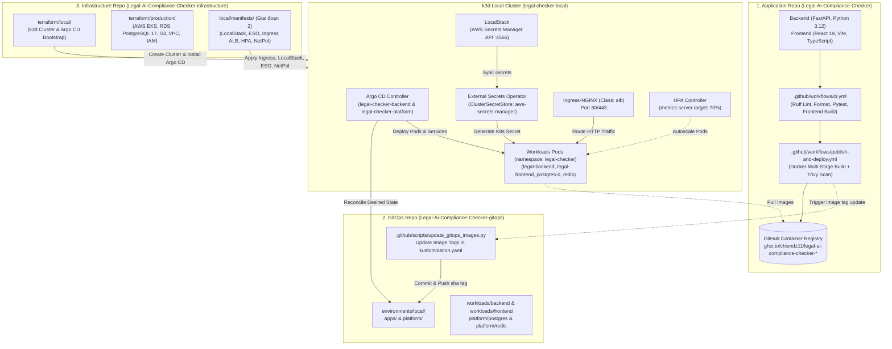
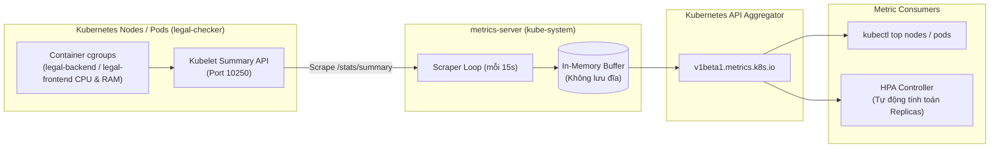
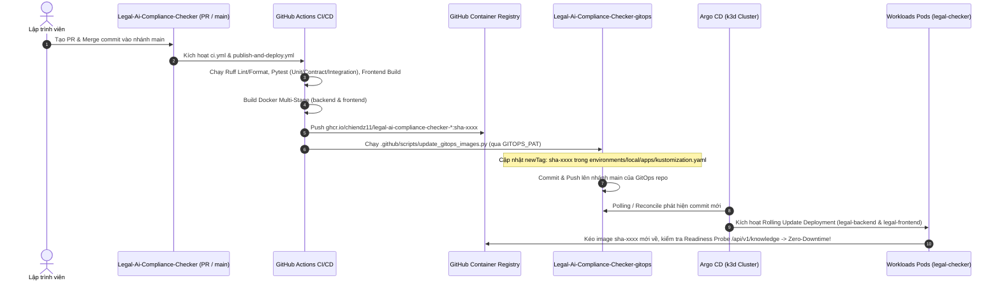
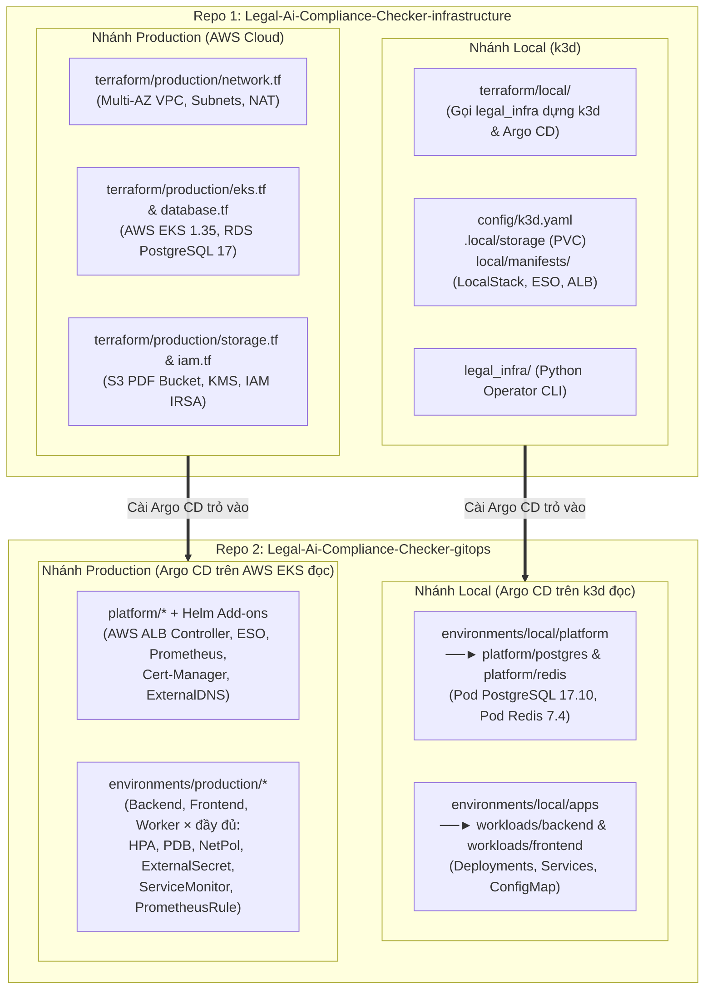
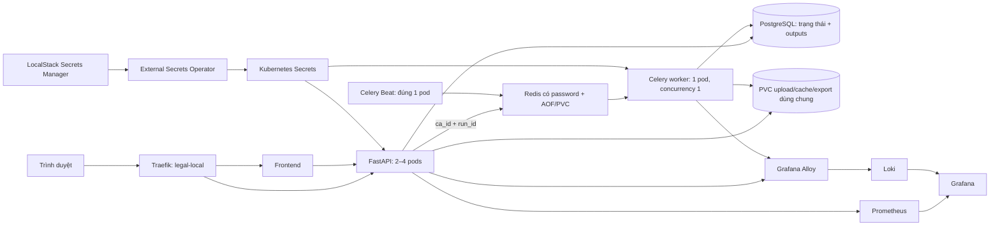

# Framework & Hướng Dẫn Tổng Quát: Cấu Hình k3d Local, Argo CD GitOps và Luồng CI/CD Đa Repository

Tài liệu này đóng vai trò là **khung chuẩn hóa (DevOps Framework)** và **sổ tay vận hành kỹ thuật (Engineering Runbook)** cho toàn bộ hệ sinh thái **Legal AI Compliance Checker**. Framework này quy định cách thức phối hợp giữa 3 repositories, quy trình cài đặt cụm Kubernetes cục bộ (`k3d`), cơ chế đồng bộ khai báo qua GitOps (`Argo CD`), kiến trúc quản lý bí mật (**LocalStack + External Secrets Operator**), và luồng tự động hóa tích hợp/phát hành liên tục (`CI/CD`).

---

## 1. Kiến Trúc Tổng Thể 3-Tier Multi-Repository

Hệ thống được tổ chức theo mô hình phân tách trách nhiệm tuyệt đối giữa **Mã nguồn ứng dụng**, **Cấu hình trạng thái khai báo (Desired State)** và **Mã nguồn hạ tầng (IaC)**:



### Bảng Trách Nhiệm Từng Repository

| Repository | Công nghệ chính | Trách nhiệm cốt lõi |
| :--- | :--- | :--- |
| **`Legal-Ai-Compliance-Checker`** | Python 3.12 (FastAPI, Pydantic v2, Psycopg 3), React 19 (Vite, TypeScript), Alembic, Docker, GitHub Actions | Chứa toàn bộ business logic kiểm tra tuân thủ hợp đồng (Nhóm A: Document Intelligence, Nhóm B: Scope/Temporal/Citation, Nhóm C: Retrieval/Compliance/Risk/Report), shared contracts, database migrations, thực thi CI/CD và đẩy Docker images lên GHCR. |
| **`Legal-Ai-Compliance-Checker-gitops`** | Kustomize, Argo CD Applications, Python Release Generator (`legal_gitops`) | Single Source of Truth lưu trữ cấu hình mong muốn (Desired State) của toàn bộ cụm K8s (`environments/local/platform`, `environments/local/apps`, `workloads/backend`, `workloads/frontend`, `ConfigMaps`, `ExternalSecrets`, `HPAs`, `PDBs`, `NetworkPolicies`). |
| **`Legal-Ai-Compliance-Checker-infrastructure`** | Terraform, k3d, Helm, Python Operator CLI (`legal_infra`), LocalStack, External Secrets Operator | Tự động hóa hạ tầng (IaC): dựng cụm `k3d` local (`legal-checker-local`), cấu hình LocalStack Secrets Manager + ESO, Ingress ALB controller, bootstrap Argo CD, và cung cấp Terraform modules cho AWS Cloud Production (`terraform/production/`). |

---

## 2. Thiết Lập & Cấu Hình Cụm `k3d` Local

Cụm `k3d` được thiết kế để mô phỏng một số cách kết nối dịch vụ AWS Production ngay trên máy trạm thông qua Docker.

### 2.1. Cấu hình Mạng & Volume Mounts (`config/k3d.yaml`)
- **Kubernetes API Endpoint**: Cụm `legal-checker-local` bind cố định trên `127.0.0.1:6561`, sử dụng kubeconfig cô lập tại `.local/kubeconfig` (không ghi đè `~/.kube/config` mặc định của máy trạm).
- **Volume Bind Mount**:
  ```yaml
  volumes:
    - volume: .local/storage:/var/lib/rancher/k3s/storage
      nodeFilters: [server:0]
  ```
  Mount thư mục cục bộ vào Rancher `local-path-provisioner` để duy trì dữ liệu PostgreSQL 17.10 (`postgres-0`) và snapshot tri thức pháp lý ngay cả khi dừng container (`k3d cluster stop legal-checker-local`).
- **Tắt dịch vụ thừa**: Khai báo `--disable=traefik` và `--disable=servicelb` trong k3s extraArgs để giải phóng cổng 80/443 cho Ingress-NGINX mô phỏng AWS ALB chuyên dụng.

### 2.2. Khởi tạo 1-Click bằng Terraform & Operator CLI
Đứng tại thư mục `Legal-Ai-Compliance-Checker-infrastructure`:
```bash
# 1. Khởi tạo cụm k3d, cấu hình secrets và cài đặt Argo CD + attach GitOps
cd terraform/local
terraform init
terraform apply -auto-approve

# 2. Áp dụng Database Migrations (Alembic) và Seed Dataset DEV_VALIDATION (300 ca)
cd ../..
.venv/bin/python -m legal_infra migrate
.venv/bin/python -m legal_infra seed \
  --workbook ../Legal-Ai-Compliance-Checker/data/private/v750_source_pdf360_r2_supabase/bang_du_lieu_runtime_v7_5_0_360_STRUCTURED_R2_SUPABASE_DEV_VALIDATION.xlsx
```

### 2.3. Cài Đặt Các Thành Phần Mở Rộng AWS Parity (Kiến Trúc Giai Đoạn 2)

Sau khi cụm `k3d` khởi động, các thành phần mô phỏng AWS Cloud-Native được triển khai để đạt chuẩn Production Parity:

1. **LocalStack (AWS Secrets Manager Simulation)**:
   - Triển khai trong namespace `localstack`, lắng nghe tại `http://localstack.localstack.svc.cluster.local:4566`.
   - Lưu trữ tập trung các bí mật nhạy cảm (`legal-checker/local/llm` chứa `OPENAI_API_KEY` / `GROQ_API_KEY`, và `legal-checker/local/database` chứa `DATABASE_URL`, `POSTGRES_PASSWORD`).
2. **External Secrets Operator (ESO)**:
   - Cài đặt qua Helm chart trong namespace `external-secrets`.
   - `ClusterSecretStore` tên `aws-secrets-manager` kết nối tới LocalStack endpoint cổng `4566`.
   - Resource `ExternalSecret` trong namespace `legal-checker` tự động đồng bộ và duy trì các Kubernetes Secrets `legal-llm-secret` và `legal-database`.
3. **Ingress-NGINX (AWS ALB Simulation)**:
   - Cấu hình với `ingressClassName: alb` lắng nghe trên cổng 80/443.
   - Định tuyến domain nội bộ: `app.legal-checker.local` (trỏ vào `legal-frontend:80`) và `api.legal-checker.local` (trỏ vào `legal-backend:8000`).
4. **Horizontal Pod Autoscaler (HPA) & Zero-Trust NetworkPolicies**:
   - Tự động co giãn `legal-backend` và `legal-frontend` dựa theo số liệu CPU/Memory từ `metrics-server`.
   - Cách ly phân vùng mạng Pod-to-Pod trong namespace `legal-checker`: chỉ cho phép `legal-frontend` gọi `legal-backend:8000`, chỉ cho phép `legal-backend` kết nối `postgres:5432` / `redis:6379`, và mở Egress cổng `443` cho `legal-backend` gọi API LLM (Google Gemini / Groq Cloud).

### 2.4. Phân Hệ Thu Thập Số Liệu Hạ Tầng: Metrics Server & Resource Metrics API

`metrics-server` là mắt xích thiết yếu trong cụm Kubernetes. Nếu không có thành phần này, HPA hoàn toàn bị "mù" và không thể thực hiện co giãn tự động khi tải đánh giá hợp đồng tăng cao.



#### 1. Bản chất & Cơ chế Hoạt động của Metrics Server
- **In-Memory Aggregator**: `metrics-server` thu thập số liệu tài nguyên tính toán (CPU cores và Memory bytes) từ Kubelet Summary API trên từng Worker Node (thông qua cgroups của container).
- **Không phải cơ sở dữ liệu**: Dữ liệu chỉ được lưu trữ tạm thời trong bộ nhớ đệm RAM (chu kỳ scrape 15 giây – 60 giây). Nó không có ổ đĩa lưu trữ (non-persistent) và không lưu dữ liệu lịch sử.
- **Đăng ký Aggregated API**: Cung cấp API endpoint `v1beta1.metrics.k8s.io` trực tiếp vào API Server của Kubernetes. Khi người dùng gõ `kubectl top` hoặc HPA Controller truy vấn, Kubernetes API Server sẽ ủy quyền (proxy) yêu cầu đến `metrics-server`.

#### 2. Vai trò đối với Horizontal Pod Autoscaler (HPA)
HPA không thể tự đọc CPU của Pod. Controller Manager định kỳ (mặc định 15 giây một lần) gọi `metrics.k8s.io` để lấy giá trị CPU thực tế của từng Pod trong Deployment `legal-backend` / `legal-frontend`. Sau đó đối chiếu với ngưỡng `averageUtilization`:

$$\text{Tỷ lệ sử dụng CPU (\%)} = \frac{\text{CPU thực tế đo bởi metrics-server}}{\text{resources.requests.cpu khai báo trong Deployment}} \times 100\%$$

Nếu tỷ lệ thực tế vượt qua ngưỡng mục tiêu (ví dụ: `70%`), HPA Controller sẽ tự động tính toán số Pod cần thiết và gọi API scale Deployment lên:

$$\text{Replicas mong muốn} = \left\lceil \text{Replicas hiện tại} \times \frac{\text{Tỷ lệ CPU hiện tại}}{\text{Tỷ lệ CPU mục tiêu}} \right\rceil$$

> [!IMPORTANT]
> **Điều kiện tiên quyết để HPA hoạt động**:
> Mọi Deployment muốn co giãn theo CPU/RAM **bắt buộc phải khai báo trường `resources.requests.cpu` (hoặc `memory`)** (hiện tại `legal-backend` đã khai báo `requests: {cpu: 100m, memory: 256Mi}`). Nếu thiếu trường này, `metrics-server` dù có đo được CPU cũng không thể tính ra tỷ lệ phần trăm, dẫn đến trạng thái lỗi `TARGETS: cpu: <unknown>/70%`.

#### 3. So sánh: `metrics-server` (k3d Local) vs `metrics-server` (AWS EKS Production)

| Tiêu chí | k3d Local Cluster (`Legal-Ai-Compliance-Checker-infrastructure`) | AWS EKS Production Cluster |
| :--- | :--- | :--- |
| **Nguồn gốc cài đặt** | Tích hợp sẵn mặc định trong bản phân phối k3s (`rancher/mirrored-metrics-server`). | EKS **không cài sẵn**; phải triển khai qua Helm chart hoặc EKS Managed Add-on. |
| **Namespace** | `kube-system` | `kube-system` |
| **Cấu hình chứng chỉ TLS** | Tự động tin cậy chứng chỉ Kubelet nội bộ của k3s container qua `--secure-port=10250` và `--cert-dir=/tmp`. | Cần cấu hình chứng chỉ TLS hợp lệ hoặc xác thực Kubelet CA chính quy trên AWS EC2 Node Group. |
| **Quyền truy cập K8s** | ServiceAccount `metrics-server` gắn `ClusterRole: system:aggregated-metrics-reader`. | Cấp quyền RBAC tương đương, gắn IAM Role nếu cần xuất audit log qua CloudWatch. |
| **Tần suất Scrape** | Mặc định 15 giây (`--metric-resolution=15s`). | Tùy biến từ 15s đến 60s tùy quy mô cụm node. |

#### 4. Phân Biệt Rạch Ròi: Metrics Server vs Prometheus

| Đặc tính | Metrics Server | Prometheus Stack (`kube-prometheus-stack`) |
| :--- | :--- | :--- |
| **Bản chất** | Công cụ đo lường lõi nhẹ (Lightweight Core Aggregator). | Nền tảng giám sát phân tán toàn diện (Enterprise Observability Platform). |
| **Lưu trữ** | **Ngắn hạn trong RAM** (In-memory, xóa sạch khi restart). | **Dài hạn trên đĩa** (Time-Series Database - TSDB, lưu nhiều tuần/tháng). |
| **Số liệu đo đạc** | **Duy nhất 2 chỉ số**: CPU và Memory của Node/Pod. | **Hàng ngàn chỉ số**: HTTP requests/s, p99 latency, DB connections, LLM token usage (`nhat_ky_goi_llm`), custom app counters. |
| **Mục đích sử dụng** | Phục vụ trực tiếp cho `kubectl top` và **HPA cơ bản** (Resource Metrics). | Phục vụ **Grafana Dashboards**, **Alertmanager Cảnh báo**, và **Custom Metrics HPA** (thông qua Prometheus Adapter). |
| **Tải tài nguyên** | Cực kỳ thấp (~100m CPU, 70Mi RAM). | Trung bình đến cao (Cần 1Gi+ RAM và Persistent Volume gp3). |

#### 5. Các Lệnh Vận Hành & Kiểm Tra Metrics Server

```bash
export KUBECONFIG="/home/chienqt/Dev/newBTL/Legal-Ai-Compliance-Checker-infrastructure/.local/kubeconfig"

# 1. Kiểm tra trạng thái sẵn sàng của Metrics API Service
kubectl get apiservice v1beta1.metrics.k8s.io
# Kết quả mong đợi: AVAILABLE = True

# 2. Xem trực tiếp mức tiêu thụ CPU/RAM của Worker Node
kubectl top nodes

# 3. Xem mức tiêu thụ CPU/RAM của các Pods trong namespace legal-checker
kubectl top pods -n legal-checker

# 4. Kiểm tra xem HPA đã nhận số liệu đo đạc hay chưa
kubectl get hpa -n legal-checker
# Kết quả mong đợi: Cột TARGETS hiển thị rõ % (ví dụ: cpu: 5%/70%), không được là <unknown>
```

---

## 3. Kiến Trúc & Vận Hành Argo CD GitOps

Argo CD vận hành theo mô hình khai báo Kustomize, đóng vai trò đồng bộ liên tục giữa repository `Legal-Ai-Compliance-Checker-gitops` và cụm Kubernetes.

### 3.1. Các Ứng Dụng Khai Báo (Argo Applications)
Trong namespace `argocd`, hệ thống quản lý 2 ứng dụng độc lập thuộc `AppProject: legal-checker`:

1. **`legal-checker-platform`**:
   - Git Path: `environments/local/platform`
   - Quản trị: `platform/postgres` (PostgreSQL 17.10 + PVC) và `platform/redis` (Redis 7.4.2 AOF + PVC tùy chọn cho hàng đợi worker).
2. **`legal-checker-backend`**:
   - Git Path: `environments/local/apps`
   - Quản trị: Toàn bộ workloads ứng dụng (`workloads/backend` — FastAPI `legal-backend`, `workloads/frontend` — Nginx/React `legal-frontend`, và ConfigMap `legal-backend-config`).

### 3.2. Cấu Hình Tự Động Đồng Bộ & Tự Khắc Phục (Self-Healing)
```yaml
spec:
  syncPolicy:
    automated:
      prune: false       # Không xóa nhầm tài nguyên stateful (PVC/Database) khi chưa kiểm soát
      selfHeal: true     # Tự động ghi đè mọi can thiệp thủ công (manual drift) về đúng trạng thái Git
    syncOptions:
    - CreateNamespace=false
    - FailOnSharedResource=true
```

### 3.3. Cơ chế Thứ Tự Triển Khai (Sync Waves)
Nhằm tránh tình trạng Pod ứng dụng khởi động trước khi Secret hoặc Database sẵn sàng, hệ thống áp dụng K8s Annotations:
- `argocd.argoproj.io/sync-wave: "-20"`: `ExternalSecrets`, `ConfigMaps` khởi tạo trước.
- `argocd.argoproj.io/sync-wave: "-10"`: Owner Database Migration Jobs (`operations/migrations/job.yaml`) khởi chạy.
- `argocd.argoproj.io/sync-wave: "0"`: Deployments của `legal-backend` và `legal-frontend` khởi động.

---

## 4. Luồng Tự Động Hóa CI/CD Xuyên Suốt (End-to-End Workflow)



### 4.1. Bước 1: Kiểm Thử Toàn Diện tại `Legal-Ai-Compliance-Checker` (`.github/workflows/ci.yml`)
Mọi Pull Request vào `main` đều bắt buộc vượt qua cổng kiểm định `CI / required`:
- **Python Lint & Format**: `ruff check` và `ruff format --check` (giới hạn dòng 100 ký tự).
- **Automated Test Suite**: Hơn 1.000 bài test Pytest kiểm tra toàn bộ 9 bước nghiệp vụ (`modules/documents`, `modules/applicable_law`, `modules/retrieval`, `modules/citation_validation`, `modules/compliance`, `modules/risk_engine`, `modules/reporting`, `shared/llm`) và tính toàn vẹn của `knowledge_snapshot_sha256`.
- **Frontend Typecheck & Production Bundle**: Kiểm tra TypeScript `tsc -b` và đóng gói Vite bundle tại `frontend/`.

### 4.2. Bước 2: Bảo Mật Container & Tiêu Chuẩn Docker
Mỗi container của hệ thống đều tuân thủ tiêu chuẩn bảo mật nghiêm ngặt:
- **Base image tối giản**: `python:3.12-slim` (cho `legal-backend`) và `node:22-alpine` / `nginx:1.27-alpine` (cho `legal-frontend`).
- **Non-root user & Read-Only Root Filesystem**: Pod `legal-backend` chạy với `runAsUser: 10001`, `readOnlyRootFilesystem: true`, `allowPrivilegeEscalation: false`, `capabilities: {drop: [ALL]}`, sử dụng `emptyDir` có giới hạn dung lượng cho `/cache` (`512Mi`) và `/tmp` (`128Mi`).

### 4.3. Bước 3: Đẩy Image & Quảng Bá GitOps (`.github/workflows/publish-and-deploy.yml`)
- Image được gắn tag bất biến theo commit SHA:
  - `ghcr.io/chiendz11/legal-ai-compliance-checker-backend:sha-<git_sha>`
  - `ghcr.io/chiendz11/legal-ai-compliance-checker-frontend:sha-<git_sha>`
- Script `.github/scripts/update_gitops_images.py` tự động clone repo `Legal-Ai-Compliance-Checker-gitops`, cập nhật `newTag: sha-<git_sha>` trong `environments/local/apps/kustomization.yaml` và push lên nhánh `main`:
  ```yaml
  images:
  - name: ghcr.io/chiendz11/legal-ai-compliance-checker-backend
    newTag: sha-5194fddf3e87cea90d1a7fb8913a98ec6a20bd9c
  - name: ghcr.io/chiendz11/legal-ai-compliance-checker-frontend
    newTag: sha-5194fddf3e87cea90d1a7fb8913a98ec6a20bd9c
  ```

### 4.4. Bước 4: Triển Khai Tự Động Không Gián Đoạn (Zero-Downtime Reconcile)
- Argo CD phát hiện commit mới trên `Legal-Ai-Compliance-Checker-gitops`, so sánh Desired State với Live State trong cụm `legal-checker-local`.
- Khởi tạo ReplicaSet mới, kéo image từ GHCR, chờ `startupProbe` (`/health`) và `readinessProbe` (`/api/v1/knowledge`) trả về `200 OK` rồi mới ngắt Pod cũ.

---

## 5. Phân Tích Toàn Diện AWS Cloud Parity: Cấu Trúc Local vs Production

Mặc dù cả **`Legal-Ai-Compliance-Checker-infrastructure`** và **`Legal-Ai-Compliance-Checker-gitops`** đều dùng chung kiến trúc chuẩn cho cả môi trường Local lẫn Production, bên trong mỗi repo được tách thành **2 nhánh môi trường riêng biệt** để xử lý sự khác biệt vật lý giữa máy trạm cá nhân (`k3d`) và đám mây AWS (`EKS`).

### 5.1. Sơ Đồ Phân Nhánh Local vs Production Trong 2 Repositories



### 5.2. Tại Sao `Legal-Ai-Compliance-Checker-gitops` Phải Tách `local/` và `production/`?

Argo CD ở cụm Local `k3d` và Argo CD ở cụm AWS `EKS` không thể trỏ chung vào một thư mục duy nhất vì **4 khác biệt kiến trúc cốt lõi**:

1. **Cơ sở dữ liệu & Lưu trữ (PostgreSQL 17, Redis, S3)**:
   - **Trên AWS Production (`terraform/production/database.tf`, `storage.tf`)**: Không tạo Pod Database trong K8s. PostgreSQL 17 chạy trên **Amazon RDS Multi-AZ** (encrypted), tài liệu hợp đồng PDF lưu trên **Amazon S3**, và hàng đợi chạy trên **Amazon ElastiCache (Redis)**.
   - **Dưới Local (`platform/postgres/`, `platform/redis/`)**: Vì không có AWS RDS vật lý, GitOps triển khai container `postgres:17.10` và `redis:7.4.2-alpine` gắn PVC ngay trong cụm `k3d`.
2. **Các Bộ Điều Khiển Hạ Tầng (Platform Controllers)**:
   - **Trên AWS Production**: Argo CD sử dụng `aws-load-balancer-controller` (gọi AWS API tạo ALB thật) và `external-dns` (gọi Route 53) thông qua quyền IAM Role (`eks.amazonaws.com/role-arn` trong `terraform/production/iam.tf`).
   - **Dưới Local**: Sử dụng `ingress-nginx` (giả lập `ingressClassName: alb`) và `LocalStack` (giả lập AWS Secrets Manager cho ESO).
3. **Địa chỉ Đích trong `network-policy.yaml`**:
   - **Trên AWS Production**: Luật Egress cổng `5432` khóa cứng vào dải CIDR của subnet Amazon RDS trong VPC (`10.20.0.0/16`).
   - **Dưới Local**: Luật Egress trỏ vào `podSelector: matchLabels: { app: postgres }` nằm chung namespace `legal-checker`.
4. **Quy trình Phát hành Độc lập (CI/CD Promotion)**:
   - Khi `Legal-Ai-Compliance-Checker` vừa build xong image mới, CI/CD tự động cập nhật tag vào `environments/local/apps/kustomization.yaml` để kiểm thử tự động trên cụm Local trước khi promote sang nhánh `production`.

### 5.3. Bảng Đối Chiếu 1-1: Thư Mục Local vs Dịch Vụ AWS Cloud Production

| Thư mục / File Local | Chức năng ở Local (`k3d`) | Dịch vụ thay thế trên AWS Cloud | Cơ chế hoạt động trên AWS Production |
| :--- | :--- | :--- | :--- |
| `.local/credentials.json` + `LocalStack` + `ESO` | Lưu trữ mật khẩu DB, `OPENAI_API_KEY` / `GROQ_API_KEY` giả lập AWS Secrets Manager | **AWS Secrets Manager** + **AWS KMS** (`iam.tf`) | Mã hóa at-rest bằng khóa KMS (`aws_kms_key.main`); phân quyền đọc qua IAM Role IRSA (`aws_iam_role.backend_irsa`). |
| `.local/storage/` (PVCs) + `/cache/uploads` | Bind-mount ổ cứng máy dev vào container k3d qua `local-path-provisioner` | **Amazon RDS PostgreSQL 17** (`database.tf`) + **Amazon S3** (`storage.tf`) | Database chạy trên RDS encrypted; file hợp đồng PDF lưu trên S3 bucket có versioning và KMS encryption. |
| `.local/kubeconfig` | File chứng chỉ CA và private key tĩnh của admin cụm k3d (`127.0.0.1:6561`) | **AWS IAM EKS Authentication** (`eks.tf`) | Dùng `aws eks update-kubeconfig`. Xác thực bằng short-lived STS tokens (15 phút), tích hợp IAM Access Entries. |
| `.local/cluster-owner.json` | Ghi nhận định danh bootstrap sở hữu cụm `legal-checker-local` | **AWS EKS Access Entries** & **IAM Roles** | Quản lý định danh truy cập cụm thông qua IAM Roles liên kết trực tiếp với Kubernetes RBAC. |
| `.local/settings.json` & `config/settings.example.json` | Tham số cấu hình môi trường local (tên cụm, ports, gitops repo) | **Terraform Variables (`variables.tf`)** & **AWS SSM Parameter Store** | Quản lý biến hạ tầng qua IaC và biến cấu hình ứng dụng qua ConfigMaps / SSM. |
| `config/k3d.yaml` | Khai báo cấu hình cụm k3d (1 server node, tắt traefik/servicelb) | **Amazon EKS Managed Cluster** + **Managed Node Groups** (`eks.tf`) | Khởi tạo EKS Control Plane v1.35 và EC2 Auto Scaling Node Group (`t3.large`, `min=2`, `max=6`) đa vùng. |
| `contracts/local-platform.json` & `versions/platform.lock.json` | Khóa phiên bản add-ons (Argo CD, Postgres 17.10, Redis 7.4.2) và contract giao tiếp | **EKS Managed Add-ons** & **`.terraform.lock.hcl`** | Khóa chặt phiên bản image digest, Kubernetes components và Terraform provider hashes. |
| `legal_infra/` (Python Operator CLI) | Tự động hóa gọi Docker, k3d, migrate, seed workbook và cài Argo CD | **Terraform AWS Provider** + **Argo CD** + **GitHub Actions** | Provisioning toàn bộ hạ tầng AWS tự động và triển khai ứng dụng qua GitOps pipeline. |

### 5.4. Giai đoạn 2 — triển khai local có worker, kiểm soát bí mật và quan sát

Mục tiêu là chạy cùng một backend modular monolith dưới hai loại tiến trình: API tiếp nhận yêu cầu và Celery worker xử lý nền. **Không cần Dockerfile worker riêng.** PostgreSQL lưu trạng thái/kết quả; Redis chuyển job. Các module nghiệp vụ vẫn là Python modules trong cùng package, không được gọi là những microservice độc lập.

Phần này thay kế hoạch cũ bằng cấu hình phù hợp checkout hiện tại. Local mô phỏng cách nối các thành phần; không chứng minh tương đương AWS 100%, HA, backup hoặc hiệu năng production.



#### 5.4.1. Worker + Redis — hạng mục chính thức của giai đoạn 2

| Thành phần | Cấu hình và mục đích |
|---|---|
| API | `ASSESSMENT_QUEUE=celery`; lưu run `QUEUED` trước khi enqueue, trả run ID để UI tiếp tục poll sau F5. |
| Redis | Dùng package `platform/redis`; URL lấy từ Secret `legal-redis/REDIS_URL`, có password. Không đưa `redis://redis:6379/0` không xác thực vào ConfigMap. |
| Worker | `workloads/worker/deployment.yaml`; dùng đúng image/tag backend, override command `celery -A legal_checker.worker.celery_app:app worker --concurrency=1`. Không mở HTTP Service cho worker. |
| Scheduler | `workloads/worker/scheduler.yaml`; chạy Beat riêng, một replica, strategy `Recreate`. Không gắn `--beat` vào mỗi worker để tránh tạo nhiều scheduler khi scale. File lịch nằm ở `/tmp`. |
| Recovery | Late ACK, reject khi process chết, prefetch=1; Beat tìm run mất job/lease hết hạn. Task gửi chỉ có IDs. Kết quả nằm trong DB, không cần Redis result backend. |
| Heartbeat | Task đã claim mới khởi động heartbeat trong lúc LLM chạy; duplicate task không được kéo dài lease của run chưa claim. Redis vẫn là at-least-once, không cam kết exactly-once. |
| File dùng chung | `workloads/storage` cấp PVC `legal-shared-files`; API và worker cùng mount `/cache`. Giữ cùng `UPLOAD_DIR`, `SOURCE_CACHE_DIR`, `REPORT_EXPORT_DIR`. RWO dùng được giữa nhiều pods trên **cùng một node k3d**; không phải storage nhiều node. |
| Kiểm tra worker | Probe Celery ping đúng hostname pod; API dùng health/knowledge; kiểm thêm một task qua Redis và trạng thái DB. Pod Ready không tự chứng minh chất lượng suy luận. |

#### 5.4.2. Secrets: LocalStack + ESO

Infrastructure sở hữu `local/manifests/localstack.yaml`, Helm chart ESO, bootstrap credentials và ClusterSecretStore `legal-local-aws`. Store giới hạn namespace `legal-checker`, endpoint chỉ trỏ LocalStack trong cluster.

GitOps sở hữu `platform/secrets/external-secrets.yaml`: ba ExternalSecrets cho database, Redis và LLM. Dùng `creationPolicy: Merge`, `deletionPolicy: Retain` để tiếp quản các Secret bootstrap hiện có mà không xóa/recreate hoặc đổi password của DB đã khởi tạo.

`legal_infra.phase2 seed-secrets` đọc Secret đang có trong bộ nhớ, bổ sung Redis URL có xác thực rồi ghi qua stdin vào Secrets Manager local. Không in API key/DSN ra terminal, không lưu chúng trong Git hoặc Terraform state. LLM key chưa có thì giữ trạng thái chưa cấu hình; không bịa key và không gọi provider để kiểm tra hạ tầng.

ESO refresh Secret không tự restart tiến trình đã nhận env. Đổi API key cần rollout API/worker có chủ đích. Rotate password PostgreSQL cần đổi password trong DB trước/đồng bộ với Secret; không sửa JSON credentials rồi coi như rotate xong. LocalStack không thay KMS/IAM hay chứng minh rotation production.

#### 5.4.3. Edge routing

Sử dụng **Traefik**, class `legal-local`. Kế hoạch cũ dùng ingress-nginx và đổi class thành `alb` không còn phù hợp: ingress-nginx đã nghỉ bảo trì trong 2026, và tên class không làm NGINX trở thành AWS ALB.

- `app.legal-checker.localhost` → frontend.
- `api.legal-checker.localhost` → backend.
- Frontend tiếp tục proxy `/api/` theo cùng origin, không cần sửa URL API khi F5.
- Service edge là NodePort `32080`/`32443`. Cluster đã có không bị xóa để thêm Docker port mapping. Dùng port-forward edge ở `127.0.0.1:18880` cho cluster cũ; cluster tạo mới có thể thêm mapping riêng sau khi review cấu hình.
- Không tự cấu hình TLS giả thành HTTPS đã tin cậy. HTTPS/cert-manager là bước riêng khi có certificate/hostname phù hợp.

#### 5.4.4. HPA, PDB và NetworkPolicy

Backend/frontend HPA: 2–4 replicas, CPU target 70%; PDB `minAvailable=1`. Worker giữ một replica/concurrency 1 để giới hạn số lượt LLM trong môi trường đồ án. PDB chỉ hạn chế voluntary disruption; một node local vẫn có thể mất toàn bộ pods khi node dừng.

Default-deny áp dụng trong namespace `legal-checker`; mở đúng DNS, frontend/edge→API, API/worker→PostgreSQL/Redis, scheduler→Redis, Prometheus→API và HTTPS public để tải PDF/gọi LLM. PostgreSQL selector thực tế là `app=legal-postgres`; Redis là `app=legal-redis`. Migration pod có label riêng được phép truy cập DB. NetworkPolicy cổng 443 không phải allowlist tên miền và không thay firewall production.

Giữ HPA làm owner của replica count qua `ignoreDifferences` ở Argo, không lặp việc đặt số replica bằng pipeline release.

#### 5.4.5. Observability

Infrastructure cài chart có version + checksum khóa tại `versions/phase2.lock.json`:

- `kube-prometheus-stack` với Prometheus/Grafana, giảm cấu hình cho một node, retention 24h; không bật exporter cho AWS control plane tưởng tượng.
- Loki single-binary, filesystem PVC local, retention 24h.
- Grafana **Alloy**, thay Promtail đã EOL, đọc log qua Kubernetes API; không cần mount Docker socket hoặc đưa log hợp đồng vào Git.

App cung cấp `/metrics` cho HTTP count/latency theo route template; không dùng case ID làm metric label. LLM metrics đọc **actual audit calls** từ PostgreSQL để thấy calls của cả worker; không lấy outputs seed làm số cuộc gọi thật. Tổng DB bị scrape ở nhiều API pods cần dùng `max`, không cộng trùng bằng `sum`. JSON logs nghiệp vụ có trace/case/run/stage; không ghi prompt, nội dung PDF hoặc API key.

GitOps thêm ServiceMonitor, PrometheusRule HTTP lỗi >5%/backend scrape down. Đây là quan sát runtime, không phải benchmark hoặc đánh giá pháp lý.

#### 5.4.6. Sửa luồng compliance nêu trong đoạn chat đính kèm

1. `LLMObservationProvider` trước đây không được truyền `BackendReview`; adapter cố ý hạ proposal về `UNKNOWN`. Luồng tích hợp nay bật policy `C07_GROUNDED_DRAFT_V1` để backend kiểm điều kiện tiếp nhận proposal thành **bản nháp**.
2. Backend kiểm context, C05, selected C06, quote/offset, legal provenance và rules; review độc lập do con người/backend cung cấp vẫn có quyền ưu tiên.
3. Quote khớp chỉ chứng minh nguồn trích. **Không biến việc quote khớp thành chứng minh predicate pháp lý đúng.** Policy máy chỉ nhận semantic contract-content draft từ catalog đã được xác minh; số liệu phải qua Decimal với facts độc lập, ngoại lệ/performance/absence thiếu căn cứ vẫn UNKNOWN. C07/C13 vẫn chờ human review.
4. Knowledge hiện seed có nhiều trạng thái `...PENDING_HUMAN`/`...CHUA_DUYET`: giữ nguyên; không sửa hàng loạt thành VERIFIED để làm đẹp kết quả. Vì vậy chạy lại không bảo đảm mọi criterion thành SATISFIED/VIOLATED.
5. C08 nay hiểu đúng hai dạng C05 của resolver thật: scope không khớp và requirement chưa được ban hành tại ngày đã biết. Candidate version, ngày không rõ hoặc thiếu chuỗi phiên bản lịch sử vẫn INSUFFICIENT. Không tự ẩn mọi UNKNOWN.

#### 5.4.7. Trình tự triển khai và giới hạn GitOps khi code chưa publish

Từ infrastructure:

```bash
# Mọi lệnh đều dùng .local/kubeconfig + k3d-legal-checker-local.
# Nếu cluster đang dừng: chỉ start, không xóa cluster/PVC.
k3d cluster start legal-checker-local --wait
.venv/bin/python -m legal_infra.phase2 install

# Khi app đã chỉnh xong: build lại chính Dockerfile đang có, rồi import.
.venv/bin/python -m legal_infra build-image --allow-dirty
.venv/bin/python -m legal_infra import-image
# Nếu schema app thay đổi mới cần migrate; không seed lại chỉ vì bật worker.
# .venv/bin/python -m legal_infra migrate

# Lấy image từ receipt và áp dụng source local chưa publish.
IMAGE=$(.venv/bin/python -c 'import json; print(json.load(open(".local/backend-image.json"))["image"])')
.venv/bin/python -m legal_infra.phase2 apply-local --image "$IMAGE"
```

`apply-local` tạm ngừng **auto-sync của đúng hai Legal applications**, ghi lại policy cũ trong private state, backup `/cache` hiện có rồi chuyển sang shared PVC. Không commit/push thay người dùng. Đây là triển khai local từ source chưa publish, **không gọi nó là Argo đã sync commit mới**. Sau khi review/publish app image và GitOps, dùng `resume-gitops` để kiểm remote revision rồi khôi phục policy; không bật lại auto-sync khi Git remote còn trỏ cấu hình giai đoạn 1.

Các mức kiểm chứng cần tách rõ: source/lint/unit tests; Helm/Kustomize render; pods/ESO/HPA; HTTP/task qua Redis; cuối cùng mới là E2E PDF→LLM→report thật. Không dùng một mức để thay cho mức khác. Xem thêm `docs/PHASE2_LOCAL.md` ở infrastructure cho lệnh quan sát và khôi phục.

---

## 6. Quy Chuẩn Bổ Sung Workload Mới Vào Hệ Thống (Onboarding Checklist)

Khi bổ sung một workload mới vào hệ thống (ví dụ: `legal-worker` xử lý hàng đợi đánh giá hợp đồng bất đồng bộ), thực hiện đúng 5 bước sau:

### Bước 1: Khai báo Entrypoint & Kiểm thử trong `Legal-Ai-Compliance-Checker`
- Đảm bảo module có entrypoint rõ ràng trong `backend/src/legal_checker/` và vượt qua toàn bộ kiểm tra `ruff check`, `ruff format --check` và `pytest` trong `.github/workflows/ci.yml`.

### Bước 2: Đóng gói Dockerfile Chuẩn Non-Root
- Sử dụng image `backend/Dockerfile` (UID `10001`, non-root, read-only root filesystem) và đăng ký vào `.github/workflows/publish-and-deploy.yml` nếu cần image riêng.

### Bước 3: Tạo Kubernetes Manifests trong `Legal-Ai-Compliance-Checker-gitops`
Tạo thư mục `workloads/<service>/`:
- `deployment.yaml`: Khai báo đầy đủ `securityContext` (UID `10001`), `startupProbe`, `readinessProbe`, `livenessProbe` và `resources.requests/limits`.
- `service.yaml`: Khai báo `ClusterIP` service nội bộ.
- `kustomization.yaml`: Liên kết các tài nguyên của workload.

### Bước 4: Khai báo ExternalSecret, HPA & NetworkPolicy (Giai đoạn 2)
- Khai báo `external-secret.yaml` đồng bộ biến môi trường nhạy cảm từ LocalStack qua ESO.
- Khai báo `hpa.yaml`, `pdb.yaml` và `network-policy.yaml` giới hạn quyền truy cập mạng.

### Bước 5: Đăng ký Workload vào Argo CD Application
Thêm đường dẫn workload vào `environments/local/apps/kustomization.yaml`:
```yaml
resources:
- ../../../workloads/backend
- ../../../workloads/frontend
- ../../../workloads/worker
```
Commit và push lên nhánh `main` của `Legal-Ai-Compliance-Checker-gitops`. Argo CD sẽ tự động phát hiện và triển khai Pod mới lên cụm!

---

## 7. Sổ Tay Vận Hành & Khắc Phục Sự Cố (Troubleshooting Runbook)

| Hiện tượng | Nguyên nhân phổ biến | Lệnh kiểm tra & Cách khắc phục |
| :--- | :--- | :--- |
| **`ImagePullBackOff`** | Tag image `sha-*` chưa build xong trên GHCR hoặc package đang để chế độ Private. | Chạy `kubectl describe pod <pod_name> -n legal-checker`. Kiểm tra workflow `Publish and Deploy` trên GitHub Actions đã hoàn tất chưa và đảm bảo package trên GHCR ở chế độ Public. |
| **`SecretSyncedError` (Giai đoạn 2)** | LocalStack chưa có key secret (`legal-checker/local/llm`) hoặc `ClusterSecretStore` mất kết nối. | Chạy `kubectl describe externalsecret -n legal-checker`. Kiểm tra Pod LocalStack: `kubectl get pods -n localstack`. Nạp lại secret vào LocalStack bằng `awslocal secretsmanager put-secret-value`. |
| **Readiness Probe `/api/v1/knowledge` trả về `503`** | Database chưa được migrate hoặc chưa chạy bước `seed` nạp bảng `knowledge.*`. | Chạy `.venv/bin/python -m legal_infra migrate` và `.venv/bin/python -m legal_infra seed --workbook ...` từ repo `Legal-Ai-Compliance-Checker-infrastructure`, sau đó restart pod `legal-backend`. |
| **Ca đánh giá AI báo lỗi `429 Rate Limit` hoặc `INVALID_SCHEMA`** | Vượt hạn mức RPM/TPM của nhà cung cấp LLM hoặc model trả về JSON sai định dạng enum. | Truy vấn trực tiếp bảng nhật ký LLM: `kubectl exec -n legal-checker postgres-0 -- psql -U legal_checker -d legal_checker_dev -c "SELECT criterion_id, status, error_code, latency_ms FROM runtime.nhat_ky_goi_llm ORDER BY created_at DESC LIMIT 20;"`. |
| **Argo CD `OutOfSync` liên tục** | Can thiệp sửa ConfigMap/Deployment trực tiếp bằng `kubectl edit` hoặc `kubectl set env` làm xung đột với Git. | Không sửa trực tiếp trên cụm. Hãy commit thay đổi vào `environments/local/apps/kustomization.yaml` trong repo `Legal-Ai-Compliance-Checker-gitops`, Argo CD (`selfHeal: true`) sẽ tự động đồng bộ sạch sẽ. |
| **HPA hiển thị `cpu: <unknown>/70%`** | `metrics-server` mới khởi động (< 30s) hoặc Deployment thiếu `resources.requests.cpu`. | Kiểm tra `kubectl top pods -n legal-checker`. Đảm bảo `workloads/*/deployment.yaml` có khai báo `resources.requests.cpu`. |
| ** Tạm dừng / Khởi động lại cụm `k3d` để tiết kiệm RAM** | Cần giải phóng tài nguyên Docker khi chưa chạy demo. | Tạm dừng cụm (giữ nguyên toàn bộ dữ liệu DB & PVC): `k3d cluster stop legal-checker-local`. Bật lại cụm khi cần làm việc tiếp: `k3d cluster start legal-checker-local`. |
