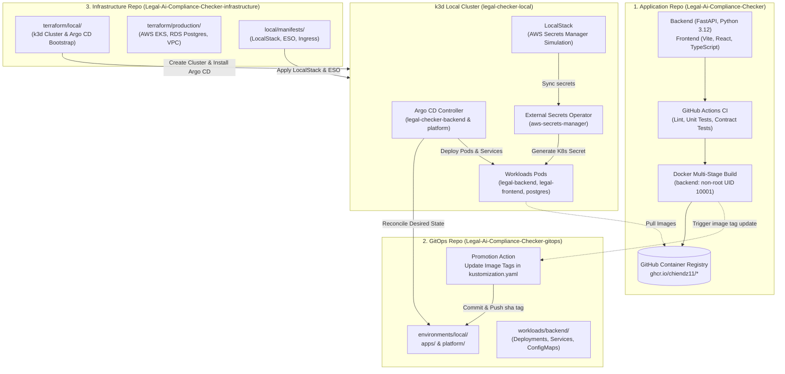
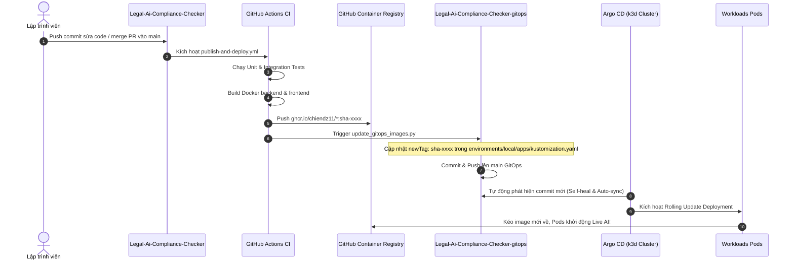

# Framework & Hướng Dẫn Tổng Quát: Cấu Hình k3d Local, Argo CD GitOps và Luồng CI/CD Đa Repository

Tài liệu này đóng vai trò là **khung chuẩn hóa (DevOps Framework)** và **sổ tay vận hành kỹ thuật (Engineering Runbook)** cho toàn bộ hệ sinh thái **Legal AI Compliance Checker**. Framework này quy định cách thức phối hợp giữa 3 repositories, quy trình cài đặt cụm Kubernetes cục bộ (`k3d`), cơ chế đồng bộ khai báo qua GitOps (`Argo CD`), và luồng tự động hóa tích hợp/phát hành liên tục (`CI/CD`).

---

## 1. Kiến Trúc Tổng Thể 3-Tier Multi-Repository

Hệ thống được tổ chức theo mô hình phân tách trách nhiệm tuyệt đối giữa Mã nguồn ứng dụng, Cấu hình trạng thái khai báo và Mã nguồn hạ tầng:



### Bảng Trách Nhiệm Từng Repository

| Repository | Công nghệ chính | Trách nhiệm cốt lõi |
| :--- | :--- | :--- |
| **`Legal-Ai-Compliance-Checker`** | Python 3.12 (FastAPI), React/Vite, Docker, GitHub Actions | Chứa business logic kiểm tra pháp lý, shared contracts, document intelligence (Nhóm A), scope & temporal (Nhóm B), compliance & risks (Nhóm C), thực thi CI, build Docker images và đẩy lên GHCR. |
| **`Legal-Ai-Compliance-Checker-gitops`** | Kustomize, Argo CD Applications | Single Source of Truth lưu trữ cấu hình mong muốn (Desired State) của toàn bộ cụm k8s (Deployments, Services, ConfigMaps, ExternalSecrets). |
| **`Legal-Ai-Compliance-Checker-infrastructure`** | Terraform, k3d, Helm, LocalStack, External Secrets Operator | Tự động hóa hạ tầng (IaC): dựng cụm k3d local, cấu hình LocalStack Secrets Manager, bootstrap Argo CD, và cung cấp Terraform scripts cho AWS Cloud Production (EKS, RDS). |

---

## 2. Thiết Lập & Cấu Hình Cụm `k3d` Local

Cụm k3d được thiết kế để tái tạo chính xác các dịch vụ Cloud ngay trên máy trạm thông qua Docker.

### 2.1. Cấu hình Mạng & Volume Mounts
- **Docker Bridge Network**: Cụm `legal-checker-local` lắng nghe trên cổng Kubernetes API `127.0.0.1:6561`.
- **Tắt dịch vụ thừa**: Khai báo `--disable=traefik` và `--disable=servicelb` trong k3s args để giải phóng cổng 80/443.

### 2.2. Khởi tạo 1-Click bằng Terraform
Đứng tại thư mục `Legal-Ai-Compliance-Checker-infrastructure`:
```bash
cd terraform/local
terraform init
terraform apply -auto-approve
```

### 2.3. Cài Đặt Các Thành Phần Mở Rộng AWS Parity

Sau khi cụm k3d khởi động, các thành phần mô phỏng AWS được nạp tự động:

1. **LocalStack (AWS Secrets Manager Simulation)**:
   - Triển khai trong namespace `localstack`, lắng nghe trên cổng `4566`.
   - Lưu trữ an toàn các bí mật nhạy cảm (`legal/prod/llm`, `legal/prod/database`).
2. **External Secrets Operator (ESO)**:
   - Cài đặt qua Helm chart trong namespace `external-secrets`.
   - `ClusterSecretStore` tên `aws-secrets-manager` trỏ tới `http://localstack.localstack.svc.cluster.local:4566`.
   - Tự động sinh ra và duy trì các Kubernetes Secrets như `legal-llm-secret`, `legal-database`.

---

## 3. Kiến Trúc & Vận Hành Argo CD GitOps

Argo CD vận hành theo mô hình khai báo khai thác Kustomize, đóng vai trò đồng bộ liên tục giữa Git repository và Kubernetes cluster.

### 3.1. Các Ứng Dụng Khai Báo (Argo Applications)
Trong namespace `argocd`, hệ thống quản lý 2 ứng dụng:
1. **`legal-checker-platform`**: Quản trị PostgreSQL 17.10/PVC và cấu hình storage.
2. **`legal-checker-backend`**: Quản trị microservices `legal-backend` và `legal-frontend`.

### 3.2. Cơ chế Thứ Tự Triển Khai (Sync Waves)
Nhằm tránh tình trạng Pod ứng dụng khởi động trước khi Secret hoặc Database sẵn sàng:
- `argocd.argoproj.io/sync-wave: "-20"`: ExternalSecrets, ConfigMaps khởi tạo trước.
- `argocd.argoproj.io/sync-wave: "-10"`: Database Migration Jobs khởi chạy.
- `argocd.argoproj.io/sync-wave: "0"`: Deployments của backend và frontend khởi động.

---

## 4. Luồng Tự Động Hóa CI/CD Xuyên Suốt (End-to-End Workflow)


