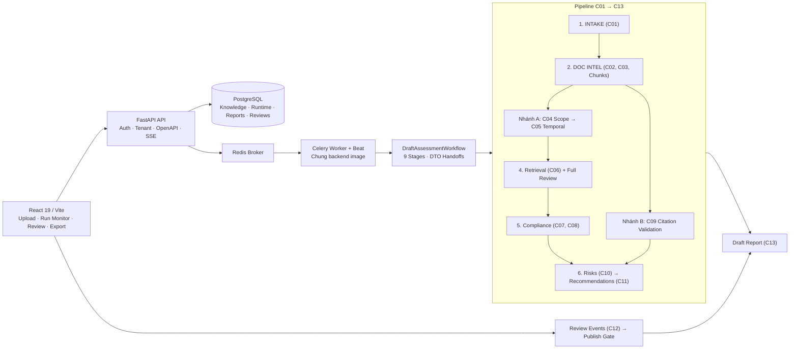

# 01 — System Overview & End-to-End Flow

> **Tài liệu thẩm quyền liên quan:** [Kiến trúc hệ thống](../architecture/system_architecture.md) · [Đặc tả tích hợp INTEGRATION_V1](../contracts/integration_spec.md) · [Hướng dẫn Data Contracts](../contracts/README.md) · [Kịch bản Demo](../guides/demo.md)  
> **Source code trung tâm:** [`assessment_workflow.py`](../../backend/src/legal_checker/workflows/assessment_workflow.py) · [`handoffs.py`](../../backend/src/legal_checker/workflows/handoffs.py) · [`steps_5_7.py`](../../backend/src/legal_checker/workflows/steps_5_7.py)

---

## 0. Trình bày nhanh (đọc phần này trước khi thuyết trình)

> **Một câu:** Hệ thống nhận một file PDF hợp đồng mua bán căn hộ, chạy 9 bước xử lý có bàn giao bằng 13 hợp đồng dữ liệu (C01–C13), và trả về báo cáo rà soát mà mọi kết luận đều chỉ được về đúng đoạn trong PDF.

**Hình dung đời thường.** Hãy nghĩ tới một văn phòng luật có nhiều bàn làm việc. Bàn 1 nhận hồ sơ và đóng dấu niêm phong. Bàn 2 đọc và đánh dấu từng đoạn. Sau đó hồ sơ tách làm hai đường: một nhóm xác định *luật nào thật sự áp dụng* cho giao dịch này, một nhóm khác chỉ kiểm tra *những văn bản mà hợp đồng tự ghi là căn cứ*. Hai nhóm không được nhìn bài của nhau. Cuối cùng kết quả được gộp lại thành danh sách rủi ro và khuyến nghị, và một luật sư duyệt trước khi phát hành. Mỗi lần chuyển hồ sơ giữa hai bàn đều có một phiếu bàn giao theo mẫu cố định — đó chính là các contract C01–C13.

**Ba ý phải nói được:**

1. **RAG thông thường không đủ** vì 5 lý do nghiệp vụ: hợp đồng tự ghi sai luật, luật chuyển tiếp rẽ nhánh, “không tìm thấy” chưa phải “không có”, dự thảo chưa có chứng từ thực hiện, và dự đoán của model không phải phê duyệt pháp lý.
2. **Ba nguyên tắc xương sống:** tách hai nhánh độc lập; trung thực với trạng thái chưa biết; mọi bàn giao đều qua DTO có kiểm tra ở biên.
3. **Modular Monolith:** một codebase, một image, nhưng các module chỉ nói chuyện qua Protocol + DTO nên vẫn giữ kỷ luật như microservices.

**Thuật ngữ dùng trong chương:**

| Thuật ngữ | Nghĩa dễ hiểu |
|---|---|
| Stage | Một trong 9 bước xử lý tuần tự của workflow, có trạng thái theo dõi riêng. |
| Contract C01–C13 | Mẫu dữ liệu bàn giao giữa hai bước (Pydantic DTO, cấm trường thừa). |
| Nhánh A / Nhánh B | A: luật thật sự áp dụng (C04→C08). B: luật mà hợp đồng tự viện dẫn (C09). |
| X01 / X02 | X01: ghim phiên bản tri thức/rule cho cả lượt chạy. X02: nhật ký mỗi lần gọi LLM. |
| `DRAFT_REVIEW` | Chế độ rà dự thảo trước khi ký — chưa xét chứng từ thực hiện giao dịch. |

**Slide tương ứng:** 4–9 trong [deck Công nghệ C01–C13](../business/slides/cong_nghe_va_ky_thuat_he_thong_c01_c13.pptx) · **Thời lượng gợi ý:** 6–8 phút.

---

## 1. Tại sao bài toán này không thể giải bằng "ChatGPT + RAG đơn thuần"?

Một cách tiếp cận RAG thông thường (cắt PDF → tìm top-K đoạn giống câu hỏi → hỏi LLM *"Hợp đồng này có vi phạm luật không?"*) sẽ sụp đổ nhanh chóng với hợp đồng mua bán căn hộ tại Việt Nam vì 5 đặc điểm nghiệp vụ sau:

1. **Hợp đồng có thể áp dụng sai hoặc không ghi rõ luật điều chỉnh:** Nhiều hợp đồng mẫu cũ vẫn ghi *"Căn cứ Luật Nhà ở 2014 và Nghị định 99/2015/NĐ-CP"* dù ngày ký thực tế rơi vào tháng 09/2024 (khi Luật Nhà ở 27/2023/QH15 và Luật KDBĐS 29/2023/QH15 đã có hiệu lực từ 01/08/2024). Nếu chỉ tìm luật theo câu chữ hợp đồng tự dẫn chiếu, hệ thống sẽ áp dụng sai bộ tiêu chí.
2. **Cùng một loại hợp đồng nhưng quy định chuyển tiếp rẽ nhánh theo sự kiện lịch sử:** Một hợp đồng mua bán căn hộ hình thành trong tương lai ký sau 01/08/2024 nhưng dự án đã đủ điều kiện bán trước 01/08/2024 có thể vẫn chịu điều chỉnh chuyển tiếp của khoản 5 Điều 83 Luật KDBĐS 2023.
3. **"Không tìm thấy trong top-K" không đồng nghĩa với "hợp đồng thiếu điều khoản":** Thiếu điều khoản bắt buộc (`MISSING`) là một kết luận pháp lý nặng; hệ thống chỉ được phép kết luận `MISSING` sau khi đã đọc toàn bộ các trang và phụ lục liên quan, không có trang lỗi chữ.
4. **Ranh giới giữa "dự thảo hợp đồng" và "quá trình thực hiện giao dịch":** Khi rà soát dự thảo trước khi ký (`DRAFT_REVIEW`), các nghĩa vụ chỉ phát sinh lúc bàn giao hoặc làm Giấy chứng nhận (chứng từ nộp tiền, biên bản bàn giao thực tế) nằm ngoài phạm vi kiểm chứng nội dung văn bản — không thể đánh dấu dự thảo là "vi phạm" chỉ vì chưa có biên lai thu tiền tương lai.
5. **Trách nhiệm giải trình & kiểm soát bởi con người:** Hệ thống hỗ trợ rà soát pháp lý tuyệt đối không được biến dự đoán xác suất của mô hình thành phê duyệt pháp lý chính thức (`COMPLETED ≠ APPROVED`).

Từ 5 vấn đề đó, toàn bộ hệ thống được tổ chức quanh **3 nguyên tắc thiết kế xương sống**:

* **Tách hai nhánh độc lập ngay từ sau C02/C03:** Nhánh A (*Applicable Law & Compliance*) quyết định luật áp dụng từ **hồ sơ giao dịch + tri thức pháp lý**, hoàn toàn độc lập với Nhánh B (*Citation Validation*) kiểm tra các văn bản mà **hợp đồng tự viện dẫn**.
* **Trung thực với trạng thái chưa biết (`UNKNOWN` / `INSUFFICIENT`):** Mọi tầng đều từ chối đoán mò. Thiếu dữ kiện giữ `UNKNOWN`, chưa đủ phạm vi giữ `OUTSIDE_REVIEW_SCOPE`, không ép mọi ca thành `COMPLIANT` hay `NON_COMPLIANT`.
* **Mọi bàn giao đều có hợp đồng dữ liệu (`C01`–`C13`) và chữ ký xác thực:** Giữa hai bước bất kỳ đều đi qua DTO Pydantic chặt chẽ (`ConfigDict(extra="forbid")`) kèm hàm kiểm tra `handoffs.py` ở biên.

---

## 2. Kiến trúc tổng thể: Modular Monolith với ranh giới Contracts

### Vì sao chọn Modular Monolith thay vì Microservices?

Trong `backend/src/legal_checker/`, mọi phân hệ (`documents`, `legal_knowledge`, `applicable_law`, `citation_validation`, `retrieval`, `compliance`, `risks`, `recommendations`, `reviews`, `reports`) chạy chung trong **một codebase và một container image**, nhưng giao tiếp với nhau thông qua **Python Protocols + Pydantic DTOs (`shared/contracts/`)** thay vì chọc chéo vào biến nội bộ hay bảng DB của nhau.

* **Lợi ích đạt được:** Không tốn chi phí mạng, serialize/deserialize HTTP nội bộ, distributed tracing hay đồng bộ schema qua 10 service riêng lẻ; `DraftAssessmentWorkflow.evaluate()` có thể chạy một mạch 9 stages trong bộ nhớ với tốc độ nhanh, rollback/debug dễ dàng trên máy local.
* **Kỷ luật được giữ nguyên như microservices:** Nhờ lớp `workflows/handoffs.py` (`validate_document`, `validate_legal`, `validate_retrieval`, `validate_compliance`, `validate_report`) và `model_copy(deep=True)` khi truyền tham số giữa các bước, không một module nào có thể âm thầm sửa payload thuộc quyền sở hữu của module trước. Nếu sau này cần tách riêng một module nặng (ví dụ GPU cho OCR/Embedding), chỉ cần thay implementation của `Protocol` (như `RetrievalService` hoặc `DocumentIntelligenceService`) mà không phải sửa workflow.



---

## 3. Bản đồ 9 Stages xử lý và 13 Data Contracts (`C01`–`C13`, `X01`–`X02`)

`workflows/states.py` định nghĩa đúng **9 stage** tuần tự được theo dõi trạng thái (`PENDING` / `RUNNING` / `COMPLETED` / `FAILED` / `SKIPPED`):

| Stage trong `STAGES` | Module thực thi | Input chính | Output Contract | Trách nhiệm cốt lõi |
|---|---|---|---|---|
| `1. INTAKE` | `documents.intake` / `assessments` | PDF + metadata + `Context` | **C01** (`AssessmentCase`), **X01** (`DeploymentSnapshot`) | Đóng băng hồ sơ ca, pin SHA-256 file nguồn, pin snapshot tri thức & chế độ đánh giá (`review_mode`). |
| `2. DOCUMENT_INTELLIGENCE` | `modules.documents` | Bytes PDF thật | **C02** (`DocumentIntelligenceResult`), **C03** (`CitationExtraction`), `Chunks` | Đọc từng trang PDF, tách chunk giữ nguyên văn & offset, trích Profile/Facts (kèm quote) và raw Citations. |
| `3. SCOPE_RESOLUTION` | `applicable_law.scope_resolver` | `ContractProfile` + `KnowledgeSnapshot` | **C04** (`ScopeResolution`) | Dùng Kleene 3-valued logic khớp điều kiện từng family trong catalog (`MATCH` / `NO_MATCH` / `UNKNOWN`). |
| `4. TEMPORAL_RESOLUTION` | `applicable_law.temporal_resolver` | `C04` + Time Markers + Policy | **C05** (`ApplicableRequirement`) | Chọn đúng phiên bản yêu cầu theo `[hieu_luc_tu, hieu_luc_den)`, marker, chuyển tiếp; áp thêm `apply_review_scope`. |
| `5. CITATION_VALIDATION` | `modules.citation_validation` | `C03` + `ContractProfile` + `KnowledgeSnapshot` | **C09** (`CitationValidation`) | Chạy **Nhánh B độc lập**: định danh, kiểm hiệu lực tại ngày ký và domain của từng viện dẫn có trong PDF. |
| `6. RETRIEVAL` | `modules.retrieval` | `C05` + `Chunks` | **C06** (`RetrievalEvidence`) | Truy xuất đoạn hợp đồng ứng viên cho từng tiêu chí cần đánh giá (BM25 + RRF + Anchors + Reranker). |
| `7. COMPLIANCE` | `modules.compliance` | `C05` + `C06` (+ `FullDocumentReviewer`) | **C07** (`CriterionResult`), **C08** (`RequirementResult`) | Xác minh điều kiện áp dụng cục bộ, gates, quy tắc số học `Decimal`, tạo finding `C07` và tổng hợp `C08`. |
| `8. RISK_AGGREGATION` | `modules.risks` | `C07` + `C09` | **C10** (`RiskResult`) | Hợp nhất rủi ro tuân thủ (từ `C07`) và rủi ro viện dẫn (từ `C09`), kiểm provenance, khử trùng lặp. |
| `9. RECOMMENDATION` | `modules.recommendations` | `C10` + `C05` + `KnowledgeSnapshot` | **C11** (`Recommendation`) | Gắn khuyến nghị hành động hoặc yêu cầu xác minh từ template đã pin và dữ liệu có thật. |
| *(Sau workflow)* | `modules.reports` & `modules.reviews` | `AssessmentDraft` (`C01`–`C11`) + `C12` | **C12** (`HumanReview`), **C13** (`FinalReport`) | Tạo bản nháp báo cáo `C13`, tiếp nhận sự kiện rà soát `C12`, kiểm tra publish gate và export PDF/DOCX/JSON. |
| *(Xuyên suốt)* | `shared.llm.audit` | Mọi cuộc gọi LLM | **X02** (`LlmAudit`) | Ghi lại provider, model, prompt version, payload SHA-256, token usage và lỗi (không lưu API key). |

> **Lưu ý về mã nguồn bước 5–7:** Các bước `COMPLIANCE`, `RISK_AGGREGATION`, `RECOMMENDATION` được đóng gói gọn trong [`workflows/steps_5_7.py`](../../backend/src/legal_checker/workflows/steps_5_7.py) (`evaluate`) để dễ hoán đổi bằng tham số `evaluator` khi chạy kiểm thử hoặc tách nhóm phát triển C.

---

## 4. Walkthrough thực tế: Một hợp đồng mua bán căn hộ đi qua hệ thống như thế nào?

Giả sử người dùng tải lên file **`HD_CanHo_A1205.pdf`** với thông tin:
* Hợp đồng mua bán căn hộ hình thành trong tương lai do Chủ đầu tư X bán cho cá nhân Y.
* Ngày ký ghi trên trang bìa và trang cuối: **`2024-09-15`**.
* Trong phần *Căn cứ pháp lý*, người soạn hợp đồng lại ghi: *"Căn cứ Luật Nhà ở số 65/2014/QH13 và Thông tư 06/2019/TT-BXD"*.
* Điều 5 quy định: *"Bên Mua thanh toán đợt 1 là 35% giá trị hợp đồng khi ký Hợp đồng"*.
* Điều 9 về bảo hành ghi: *"Thời hạn bảo hành căn hộ là 36 tháng kể từ ngày bàn giao"*.
* Người dùng chọn chế độ **`DRAFT_REVIEW`** (Rà soát dự thảo trước khi ký).

Dưới đây là biến đổi thực tế từng bước bên trong `DraftAssessmentWorkflow.evaluate()`:

```
[PDF bytes]
   │
   ▼ 1. INTAKE (C01)
   ├── Gắn source SHA-256, assessment_context.review_mode = "DRAFT_REVIEW"
   ├── Pin knowledge_snapshot_sha256 (323 requirement families, 479 criteria)
   │
   ▼ 2. DOCUMENT_INTELLIGENCE (C02, C03, Chunks)
   ├── Đọc toàn bộ 42 trang (all_pages_have_text = true) -> cắt thành các Chunk nguyên văn giữ global_start/global_end
   ├── Profile (C02): loai_hop_dong="MUA_BAN_CAN_HO", tinh_trang_tai_san="HINH_THANH_TRONG_TUONG_LAI",
   │                  ben_ban_la_chu_dau_tu=True, la_nha_o_xa_hoi=False, SIGNING="2024-09-15"
   ├── Facts trích có quote: ty_le_thanh_toan_dot_1 = 35%, thoi_han_bao_hanh = 36 tháng
   └── Citations (C03): tìm thấy chuỗi raw "Luật Nhà ở số 65/2014/QH13", "Thông tư 06/2019/TT-BXD"
         │
         ├───────────────────────────────────────────────────────────┐
         ▼ 3 & 4. NHÁNH A: C04 SCOPE + C05 TEMPORAL                  ▼ 5. NHÁNH B: C09 CITATION VALIDATION
   • Không đọc C03! Chỉ đọc C02 + KnowledgeSnapshot.           • Kiểm tra "Luật Nhà ở 65/2014/QH13" tại 2024-09-15
   • Tại ngày 2024-09-15: Luật Nhà ở 27/2023 và KDBĐS 29/2023    -> Đã hết hiệu lực từ 01/08/2024 -> STALE!
     đã có hiệu lực -> C05 chọn version năm 2024 (tối đa         • C09 KHÔNG thay đổi checklist của Nhánh A; nó chỉ tạo
     đợt 1 = 30%, bảo hành chung cư tối thiểu 60 tháng).         phát hiện citation riêng để đẩy sang nhánh rủi ro.
   • Một số tiêu chí về biên bản nghiệm thu/thu tiền thực tế
     được `apply_review_scope()` đánh dấu OUTSIDE_REVIEW_SCOPE
     vì chế độ đang là DRAFT_REVIEW.
         │                                                           │
         ▼ 6. RETRIEVAL (C06) + Selective Full-Doc Review            │
   • Đưa đoạn Điều 5 ("thanh toán đợt 1 là 35%") & Điều 9            │
     ("bảo hành 36 tháng") vào candidate pool của đúng criterion.    │
         │                                                           │
         ▼ 7. COMPLIANCE (C07, C08)                                  │
   • Criterion thanh toán đợt 1: 35% > 30% (check Decimal) -> VIOLATED (có evidence + gates đạt)
   • Criterion bảo hành: 36 tháng < 60 tháng -> VIOLATED
   • C08 tổng hợp theo `AGG_CAN_HO_V1` -> NON_COMPLIANT cho 2 family đó;
     các family chỉ xét lúc thực hiện giữ disposition OUTSIDE_REVIEW_SCOPE.
         │                                                           │
         └──────────────────────────┬────────────────────────────────┘
                                    ▼ 8 & 9. RISKS (C10) & RECOMMENDATIONS (C11)
                            • Gộp Compliance Risks (đợt 1 > 30%, bảo hành < 60 tháng)
                              + Citation Risks (dẫn chiếu Luật 65/2014 đã STALE).
                            • Sinh C11 theo template + binding đúng quote thực tế (không bịa số mới).
                                    │
                                    ▼ C13 DRAFT REPORT & C12 HUMAN REVIEW
                            • Lưu Report DRAFT. Reviewer xem PDF song song, xác nhận/override qua C12.
                            • Hết mục chặn mới được Publish & Export bản có SHA-256.
```

**Điểm chốt cần nhớ:** Nhờ hai nhánh tách biệt, dù hợp đồng viện dẫn nhầm sang Luật Nhà ở 2014 (đã hết hiệu lực tại `2024-09-15`), **Nhánh A vẫn chấm đúng theo Luật Nhà ở 2023 & Luật KDBĐS 2023** (nhờ hồ sơ ngày ký `2024-09-15`), đồng thời **Nhánh B vẫn bắt được lỗi dẫn chiếu văn bản cũ (`STALE`)** để cảnh báo sửa phần Căn cứ pháp lý.

---

## Hỏi – đáp khi trình bày

**Hỏi: Sao không tách microservices cho “chuẩn”?**  
Đáp: Vì chưa có nhu cầu scale riêng từng module, trong khi chi phí mạng, đồng bộ schema và tracing giữa ~10 service là có thật. Ranh giới vẫn được giữ bằng Protocol + DTO + `handoffs.py`; khi cần tách (ví dụ OCR/embedding cần GPU) chỉ thay hiện thực của Protocol.

**Hỏi: Nếu hợp đồng ghi sai luật căn cứ thì kết quả có sai theo không?**  
Đáp: Không. Nhánh A không đọc viện dẫn của hợp đồng; nó chọn luật từ hồ sơ giao dịch và ngày ký. Lỗi viện dẫn được Nhánh B báo riêng (xem ví dụ A1205 ở §4).

**Hỏi: 9 stage và 13 contract khác nhau thế nào?**  
Đáp: Stage là *bước chạy* (có trạng thái RUNNING/COMPLETED). Contract là *dữ liệu bàn giao*. Một stage có thể sinh nhiều contract (stage 2 sinh C02 và C03), và C12/C13 nằm sau workflow.

**Hiểu lầm hay gặp cần tránh khi nói:**

* Đừng nói “AI kết luận hợp đồng vi phạm”. Nói đúng là: AI đề xuất, backend kiểm chứng, engine tất định ra nhãn, người duyệt quyết định.
* `COMPLETED` chỉ nghĩa là lượt chạy xong và có bản nháp; không đồng nghĩa báo cáo đã được duyệt.

---

## 5. Đọc tiếp & Tham chiếu nhanh

* **Bước kế tiếp trong bộ Deep Dive:** [02 — Knowledge, Runtime & Gold Master](02-knowledge-runtime-and-gold-master.md)
* **Đối chiếu code:**
  * [`DraftAssessmentWorkflow`](../../backend/src/legal_checker/workflows/assessment_workflow.py) — điều phối toàn bộ thứ tự 9 stages và `validate_legal` / `validate_retrieval`.
  * [`handoffs.py`](../../backend/src/legal_checker/workflows/handoffs.py) — các hàm `validate_case`, `validate_document`, `validate_legal`, `validate_retrieval`, `validate_compliance`, `validate_report` chặn lỗi tràn dữ liệu giữa các module.
  * [`common.py`](../../backend/src/legal_checker/shared/contracts/common.py) — định nghĩa `Context`, `DeploymentPin`, `Finding`, `RequirementStatus`.
